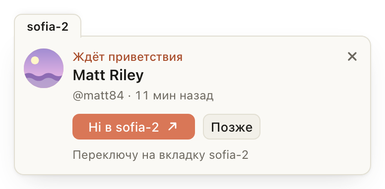
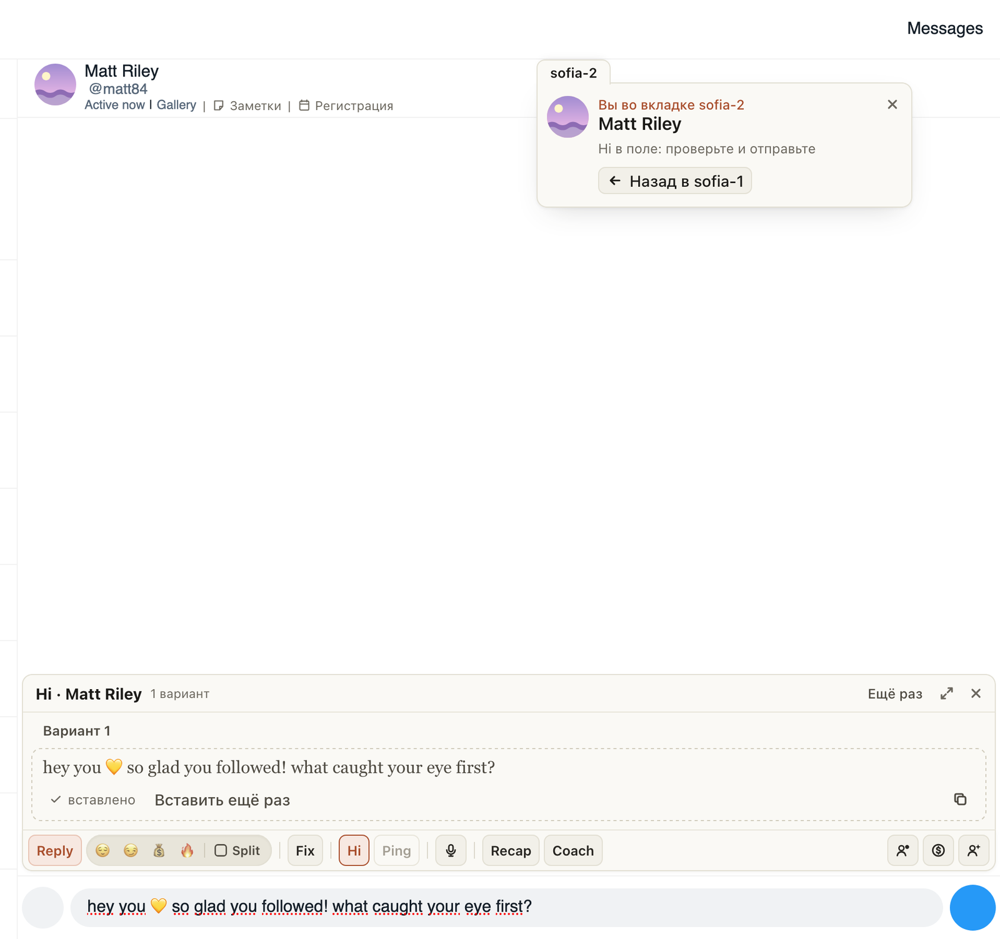

# Hi из напоминания про фана другой страницы: видно, куда переключит, и есть «Назад»

Напоминание «Ждёт приветствия» на Fansly приходит во все открытые вкладки. Если фан с другой страницы, Hi
переключал на её вкладку без предупреждения, и было непонятно, где вы оказались.

Теперь у такого напоминания сверху ушко с названием страницы фана, а кнопка говорит, куда ведёт: «Hi в sofia-2 ↗»
и строка «Переключу на вкладку sofia-2». Напоминание про фана вашей вкладки выглядит как раньше.

На вкладке, куда переключило, в том же углу та же карточка: «Вы во вкладке sofia-2», что с приветствием («Пишу
приветствие…», «Hi в поле: проверьте и отправьте», «Отправлено») и кнопка «Назад в sofia-1». Чат в первой вкладке
остаётся как был. Сами вкладки Fansly подписаны страницей: «sofia-2 · Fansly».

## Как это устроено

Страницы называются метками хаба (lora-1, lora-2): у страниц одной модели в хабе одно имя, и прежняя подпись
«· Lora Vie» их не различала. Ушко и подпись есть только у напоминания, которое стоит во вкладке другой страницы.

Hi такого напоминания, как и раньше, выводит вперёд вкладку страницы фана, открывает его чат, пишет приветствие
и кладёт его в поле. Отправляете вы сами. Теперь вместе с нажатием туда передаётся, из какой вкладки оно пришло и
каким было напоминание, поэтому карточка там та же. Она уходит через 15 секунд после отправки, когда вы открываете
другой чат, по крестику или по «Назад». «Назад» выводит вперёд прежнюю вкладку (если её перезагрузили, любую
вкладку той страницы). Если её уже нет, расширение так и скажет. Ничего не отправляется само.

Подпись вкладки берётся из того, к какой странице хаба привязан аккаунт Fansly в этой вкладке. Fansly сам меняет
заголовок при переходах, подпись возвращается каждый раз.
