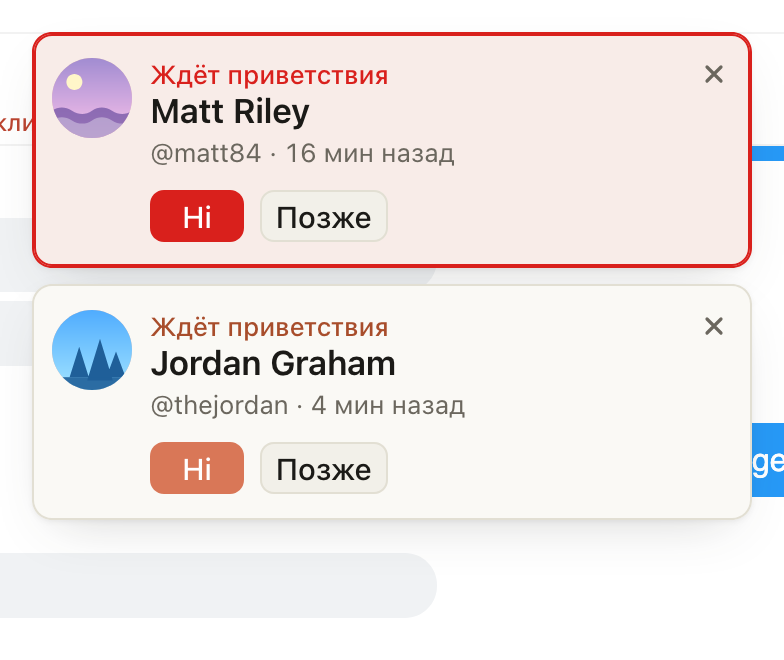

# Напоминание «Ждёт приветствия» приходит через 3, 10 и 15 минут

Раньше напоминание о фане, с которым не поздоровались, приходило один раз, через 10 минут после подписки (на
Fansly после фолова). Теперь первое приходит уже через 3 минуты, второе через 10, а третье, через 15 минут,
красное: фан ждёт слишком долго. Если закрыть напоминание или нажать «Позже», следующее всё равно придёт в свой
срок. Как только фана поприветствовали или он написал сам, напоминаний о нём больше не будет.

## Как это устроено

Сроки считаются от подписки по часам хаба на OnlyFans и от фолова на Fansly. Перед каждым напоминанием
расширение заново проверяет, что фану никто не писал и он не писал сам: на OnlyFans по списку «Новые», на Fansly
по чату фана (несколько запросов на чтение от имени модели, как и раньше). Новое напоминание о том же фане встаёт
на место прежнего, если то ещё на экране. Если вкладка модели была закрыта и срок прошёл, придёт только самое
позднее из пропущенных напоминаний. Через час после подписки фан остаётся только в «Новых».
