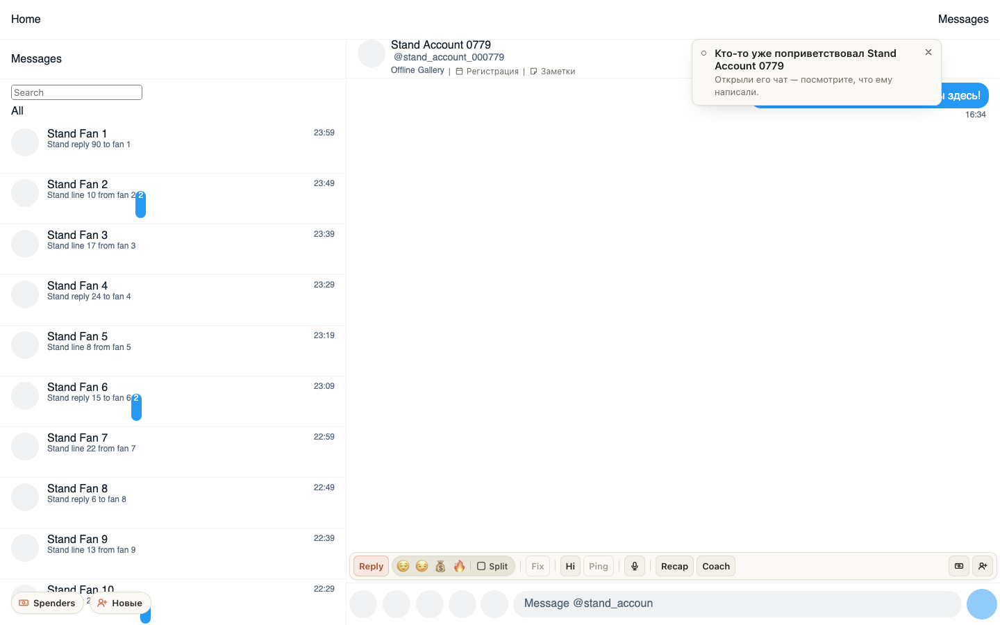
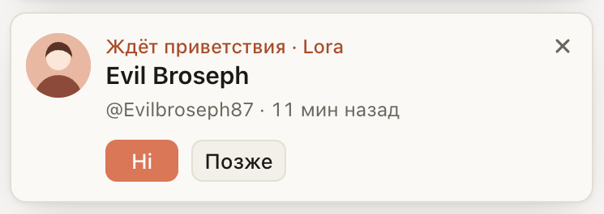

# «Ждёт приветствия» видно в той вкладке, где вы работаете, и Hi не здоровается второй раз

На Fansly уведомление о фане, которого не поприветствовали, раньше приходило только в одну вкладку его модели. Если
вы в это время работали во вкладке другой модели, оно оставалось в фоне, и вы его не видели. Теперь оно приходит и во
вкладку, которая у вас на экране. Над именем фана написано, чья это модель. Hi переключает на вкладку этой модели и
пишет приветствие там.

Если фана уже кто-то поприветствовал, Hi не напишет ему второй раз: генерация останавливается, вкладка открывает его
чат, а уведомление пишет «Кто-то уже поприветствовал …». Это работает на обоих сайтах.

## Как это устроено

Fansly: уведомление уходит во вкладку модели (ту, что на экране, иначе последнюю, где вы работали) и во все вкладки
Fansly, которые сейчас на экране. Hi в чужой вкладке передаёт нажатие во вкладку модели через расширение и выводит её
вперёд; если такой вкладки уже нет, уведомление скажет об этом. Пока Hi пишет приветствие, расширение заново читает чат
фана, только чтение. Если там уже есть личное сообщение модели, генерация отменяется, а готовый текст в поле не
попадает. Окно «Новые фоловеры» после Hi открывается на вкладке «Все», а не «К обработке»: там видно и фана, которому уже
написали.

ChatSpace: перед Hi расширение заново читает «Новые» у хаба. Если там видно, что фану уже написали, через Hi или вручную
в ChatSpace, Hi не запускается и открывается его чат.
