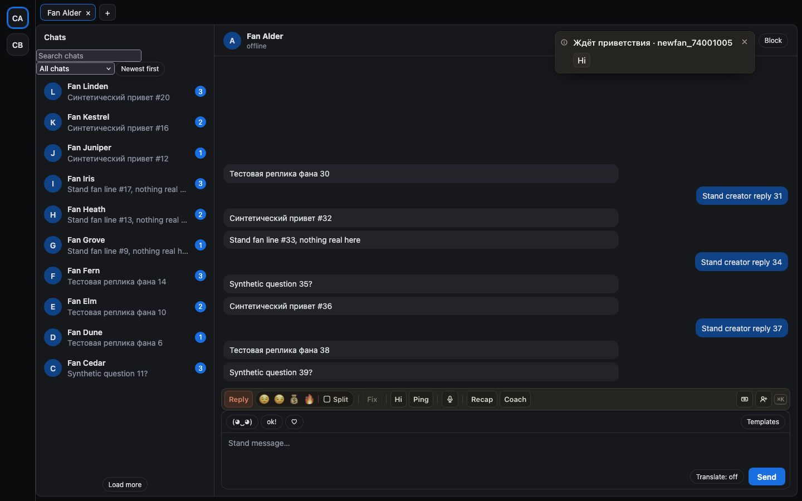

# Напоминание о фане, с которым не поздоровались, и Hi прямо из него

Если новый подписчик за 10 минут так и не получил приветствие и сам не написал, справа вверху появится
уведомление «Ждёт приветствия · имя фана» с кнопкой Hi. Hi открывает «Новые» на карточке этого фана и сразу
пишет ему приветствие в поле — останется проверить и нажать «Отправить».

Уведомление само не пропадает: закройте его ×, если фаном уже занимается кто-то другой. О каждом фане оно
приходит один раз и только во вкладку, где открыта его модель.

## Как это устроено

Расширение и так раз в минуту читает «Новые» у хаба (для звука подписки) — теперь эти же данные смотрит
и напоминание, даже если звук выключен. Фан попадает в напоминание, когда с подписки прошло от 10 минут до
часа по часам хаба, подписка не закончилась, приветствия нет ни через Hi, ни от руки в ChatSpace, а фан ещё
не писал. Те, кто старше часа, остаются только в списке «Новые». Hi в уведомлении — то же, что Hi в карточке:
ничего не отправляется само, и если фана тем временем поприветствовали, карточка скажет «Уже поздоровались».
