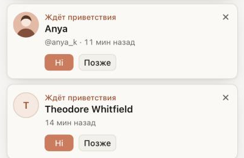
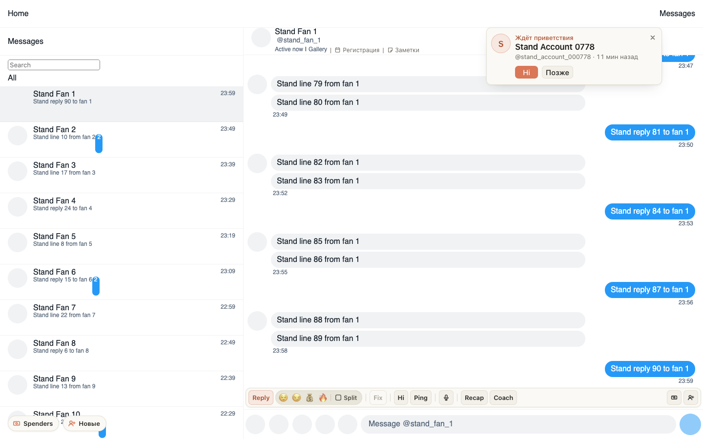

# «Ждёт приветствия» — карточкой фана: аватарка, имя, ник и сколько минут прошло

Уведомление о фане, которого не поприветствовали, теперь сразу показывает, кто это: аватарку фана, имя крупно,
@ник и сколько минут прошло с подписки. Hi — заметная кнопка в цвет расширения, «Позже» закрывает уведомление,
как и ×.

## Как это устроено

На Fansly аватарка и ник берутся из профиля фана тем же запросом, которым расширение и так читало его имя, — новых
запросов нет. В ChatSpace у фанов из «Новых» хаба аватарки нет: там в кружке первая буква имени. Если картинка
не загрузилась, тоже остаётся буква. «Минут назад» обновляется само, пока уведомление на экране.
