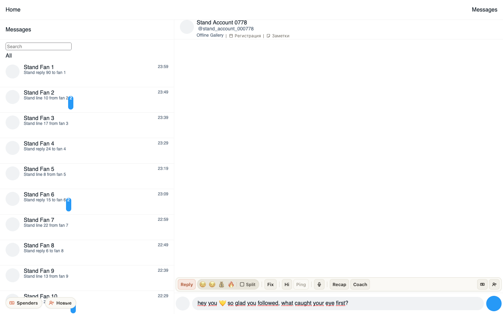
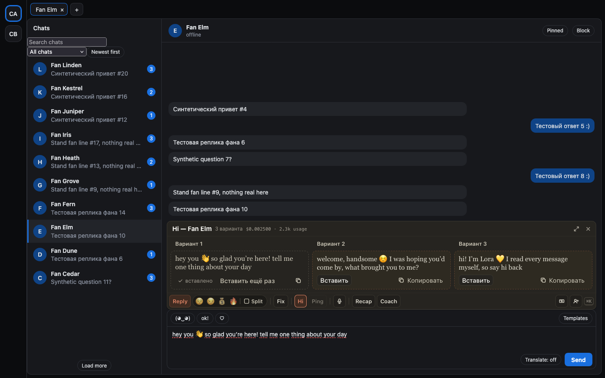

# Hi в «Ждёт приветствия» сразу пишет приветствие и вставляет его в чат фана

Раньше Hi в уведомлении только открывал карточку фана в «Новых», а дальше нужно было нажать «Открыть и вставить»
самому. Если окно «Новых» открывалось с нуля и фан ещё не был проверен, приветствие вообще не писалось — приходилось
нажимать «Сгенерировать». Теперь одно нажатие Hi делает всё: открывается карточка, приветствие пишется, и чат фана
открывается с готовым текстом в поле. Остаётся прочитать и нажать «Отправить» самого сайта — само расширение
ничего не отправляет.

Если пока писалось приветствие, вы закрыли окно или перешли к другому фану, чат не откроется: текст останется в
карточке фана.

## Как это устроено

Нажатие Hi даёт расширению право на два действия по этому одному нажатию: написать приветствие и открыть чат с ним.
Право действует две минуты: этого хватает, чтобы окно «Новых» проверило фана (ждём до 45 секунд вместо прежних 8)
и Hi дописал текст. На Fansly текст пишется в карточке «Новых фоловеров» и вставляется так же, как кнопкой
«Открыть и вставить»; в ChatSpace — в превью фана и вставляется его «Открыть и вставить». Над открытой карточкой
«Новых фоловеров» больше не всплывает «AI готово · фан»: приветствие и так видно в поле карточки.
