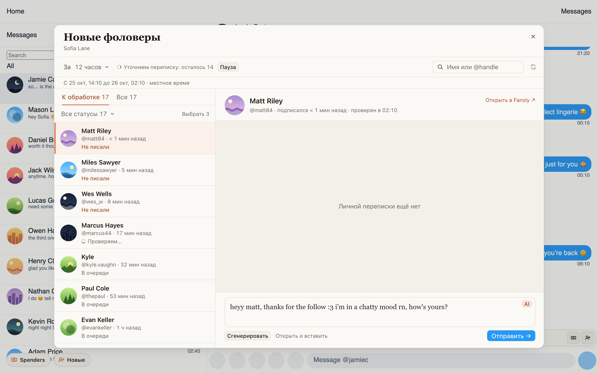

# Hi снова обращается к новому фану по имени

На Fansly примерно каждое седьмое приветствие новому фоловеру уходило без имени и без отсылки к его
профилю, хотя имя видно прямо на экране: Jayden, John и Adrian получали тот же текст, что и фан с
ником из цифр. Теперь Hi знает имя, ник и описание профиля фана с первой секунды после подписки, и в
открытом чате, и в «Новых фоловерах».

Ещё Hi теперь читает имя внутри ника на обоих сайтах: «romamai» становится «roma», «John__2002» становится
«john». Если имя только угадано по нику, Hi может спросить его в лёгкой форме («your name's roma,
right?»). Ник без имени (цифры, случайные буквы, грубое слово) Hi не трогает.

## Как это устроено

Хаб узнаёт нового фоловера Fansly только через 10–120 секунд после того, как ушло первое сообщение,
поэтому для свежего фана у него не было ни имени, ни описания, и в запрос уходило «fan». Старое
расширение Fansly само читало аккаунт фана перед каждым Hi, поэтому у него такого не было.

Теперь расширение берёт имя, ник и описание из аккаунта, который страница Fansly или проверка «Новых
фоловеров» уже прочитали (там же, откуда берётся аватарка), и передаёт их вместе с Hi. Хаб берёт их
только там, где своих данных о фане у него нет. На OnlyFans имя по-прежнему берётся из данных хаба.
