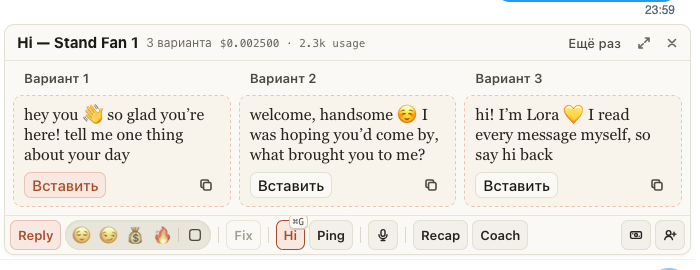

# Три варианта Hi стоят ровно, кнопки — внутри карточек

Для тех, у кого поле чата средней ширины: Hi ставит три варианта рядом, и кнопка «Вставить» вылезала за край
карточки, а карточки были разной высоты. Теперь карточки одной высоты, «Вставить» у каждой внизу слева, на одной
линии во всех трёх, «Копировать» — в том же ряду справа. В узкой колонке «Копировать» — значок с подсказкой, на
широком поле — словом.

## Как это устроено

Карточки тянутся до высоты самой длинной, кнопки прижаты к низу. Колонка варианта сама решает по своей ширине:
уже 280 px — «Копировать» значком. Если кнопки всё равно не помещаются (например, «✓ Вставлено · Вставить ещё
раз»), они переносятся на вторую строку, а не выходят за край. Варианты столбиком на узком поле не изменились.
