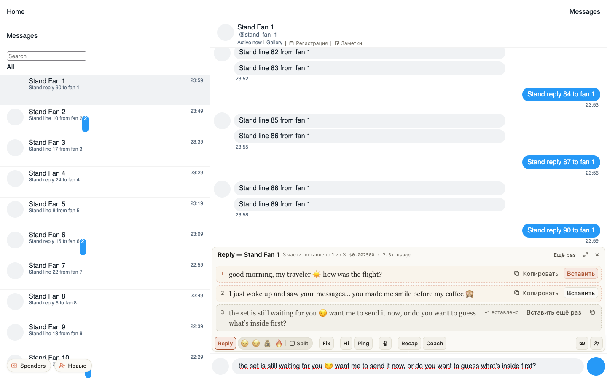

# Вставленная часть ответа больше не прыгает под курсором

Когда вы наводили мышь на уже вставленную часть ответа, надпись «вставлено» пропадала, текст
переносился по-новому, и вся карточка вместе с чатом дёргалась вверх-вниз. Теперь «вставлено» и
«Вставить ещё раз» стоят рядом и при наведении: карточка не меняет высоту.

## Как это устроено

У вставленной части, которая остаётся развёрнутой, наведение прятало метку «вставлено». Строка
становилась шире, текст переносился иначе, и высота карточки менялась. Теперь метка прячется
при наведении только у свёрнутой в одну строку части, где перенос невозможен.
