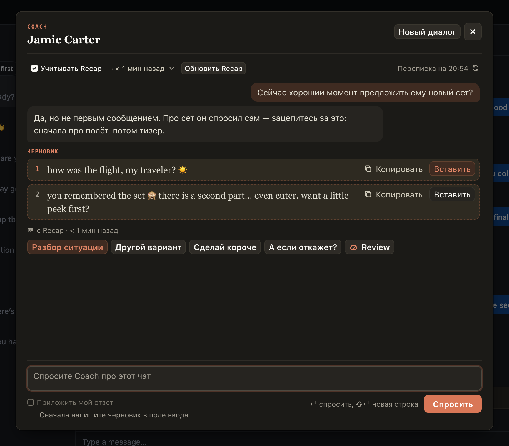
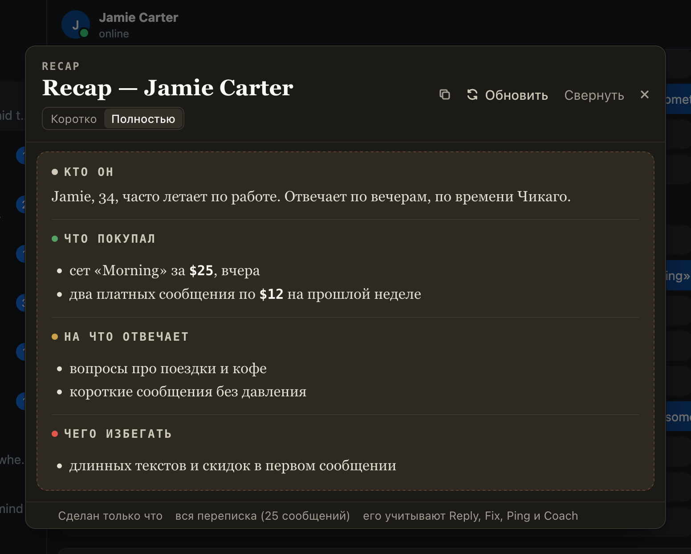

# Coach, Recap и Review: разбор фана и ваших ответов

Для чата, который вы плохо помните или приняли от сменщика. Recap (⌘⇧S) — сводка по фану: кто он, что покупал,
о чём говорили, коротко или полностью. Coach (⌘⇧C) — окно над чатом: спросите о чате своими словами и получите
совет с готовыми черновиками. Review (⌘⇧B) — кнопка в Coach: оценка вашей переписки с ошибками, «как надо
было» и рекомендациями, о ней можно спросить дальше.

## Как это устроено

Recap собирается по архиву переписки в хабе. Сохранённый Recap видят все чаттеры страницы, а Reply, Ping и
Coach учитывают его, пока стоит галочка «с Recap». Coach помнит диалог вместе с Review в нём, «Новый диалог»
начинает с чистого листа. На Windows вместо ⌘⇧ — Ctrl+Alt.
