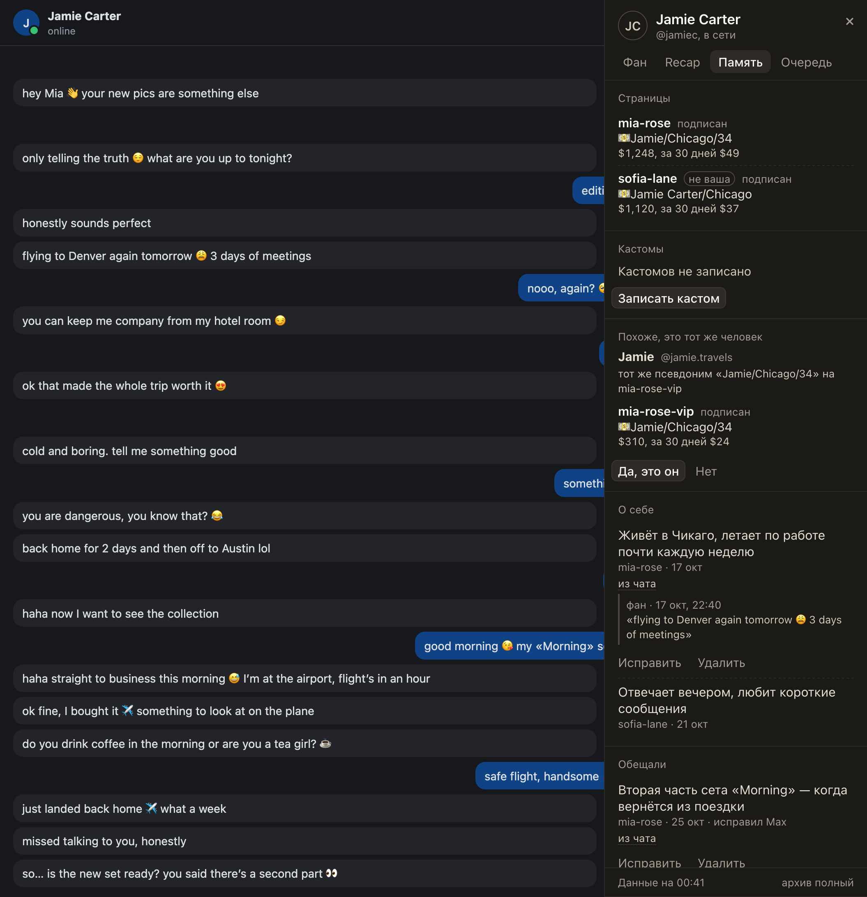
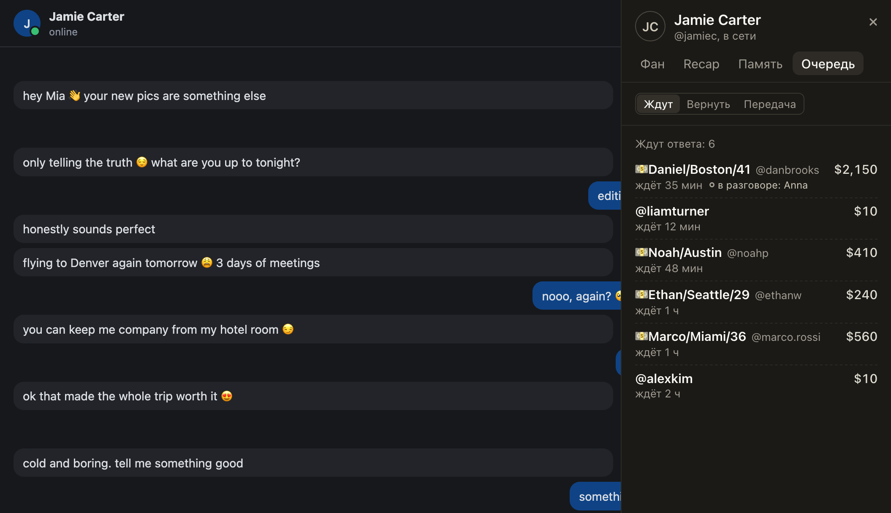

# Панель фана: Память, Очередь и кто сейчас говорит с фаном

Клавиша ] открывает панель справа от чата. В «Памяти» все страницы, где есть этот фан, с отметками команды и
тратами; что он рассказывал, что ему обещали и о чём договорились, и у каждого факта сообщение, откуда он взят;
кастомы с оплатой и выдачей. «Очередь» про страницу: кто ждёт ответа, кого вернуть сейчас и что передать следующей
смене.

Если с фаном прямо сейчас говорит коллега, над панелью в чате стоит «С ним сейчас говорит Никита», а в
Spenders и «Новых» пометка «в разговоре».

## Как это устроено

Панель читает хаб, только пока открыта. Факты записывает ИИ после разговора, исправляете и удаляете вы; связать
аккаунты одного человека решает чаттер, хаб только подсказывает. Оплату и выдачу кастома вы отмечаете одним
касанием по подсказке хаба. Пометка «в разговоре» ставится по сообщениям коллег за последние 15 минут.
