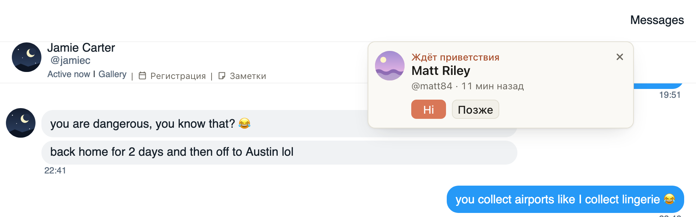

# «Ждёт приветствия»: карточка нового фана, которому никто не написал, и Hi прямо из неё

Если новый фан 10 минут ждёт приветствия, справа вверху появится его карточка. Hi в ней пишет приветствие и
открывает чат фана с готовым текстом в поле: остаётся нажать «Отправить» сайта. Если фану тем временем уже
написал коллега, Hi второй раз не поздоровается, а откроет его чат.

## Как это устроено

Карточка приходит в ту вкладку, где вы работаете. На Fansly это вкладка модели и все вкладки Fansly на
экране; Hi из другой вкладки передаёт нажатие вкладке модели и выводит её вперёд. Приветствие пишется так же,
как кнопкой «Открыть и вставить»: на Fansly в карточке «Новых фоловеров», в ChatSpace в превью фана.

Двое не поприветствуют одного фана: хаб видит, кому уже написали, а перед Hi расширение проверяет ещё раз (на
Fansly читает чат фана, в ChatSpace спрашивает «Новые» у хаба). Карточка сама не пропадает: закройте её ×, если
фаном занимается кто-то другой. Между отправками полсекунды паузы.
