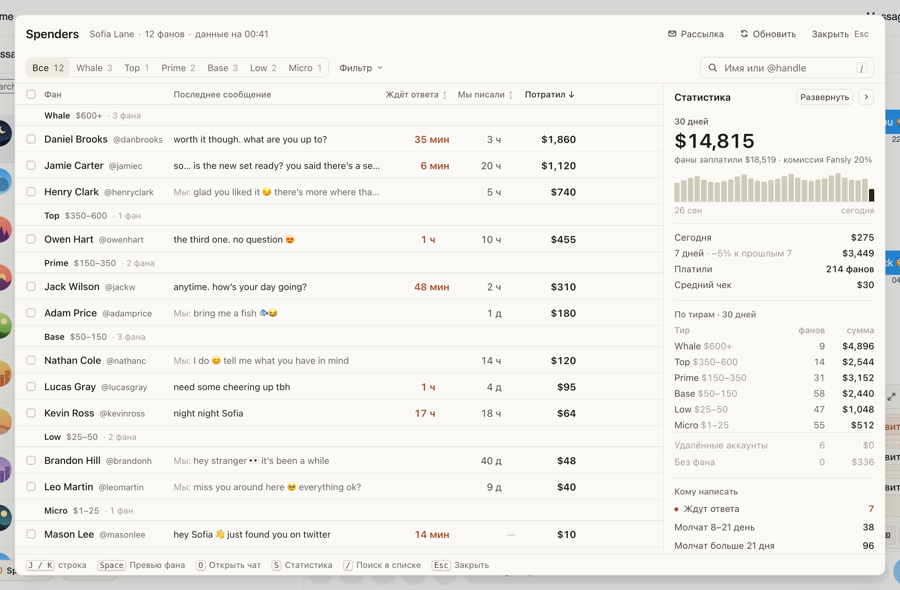
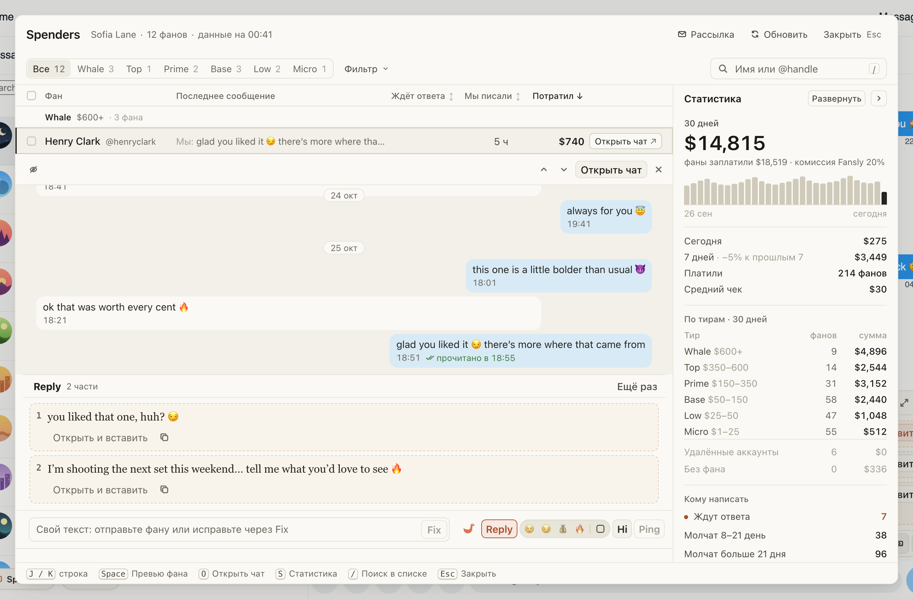

# Spenders: кто платит, кто прочитал и кому написать

⌘⇧M открывает всех платящих фанов страницы по тирам — от 🐳 Whale до Micro, по сумме за всё время и «+$N» за
30 дней. Справа — статистика страницы и «Кому написать»: кто ждёт ответа и кто давно молчит.

Нажмите на фана — его переписка раскроется под строкой, а чат на сайте останется непрочитанным. Там же видно,
прочитал ли фан ваше последнее сообщение, и можно подготовить Reply, Hi или Ping. «Рассылка» предлагает новый
PPV крупным фанам лично: ИИ подстраивает текст под каждого, вы отправляете по одному.

## Как это устроено

Суммы и статистика приходят из хаба, в нетто модели. Превью читает переписку, не открывая чат; на ChatSpace
пометку «прочитано» расширение берёт из истории чата, только когда ваше сообщение в нём последнее и
непрочитанного от фана нет. «в разговоре: Никита» значит, что фану сейчас пишет коллега. В рассылке одно
«Отправить» — одно сообщение одному фану, повторов нет.
