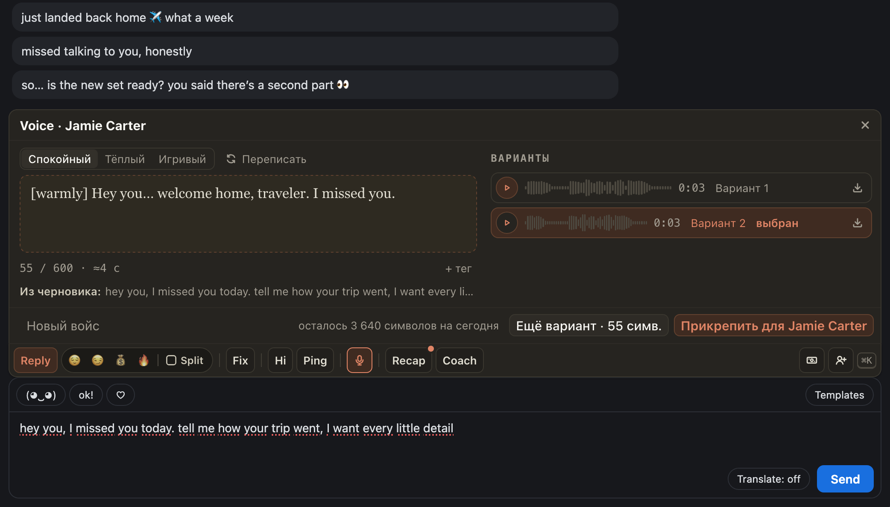

# Voice теперь и на OnlyFans: голосовое голосом модели из вашего черновика

Голосовые, которые были в расширении для Fansly, теперь есть и в ChatSpace. Напишите в поле, что сказать фану,
и нажмите 🎙 в панели. ChatGoose подготовит скрипт для озвучки: его можно поправить, выбрать подачу
(спокойную, тёплую или игривую) и добавить шёпот, смешок или паузу. «Озвучить» делает вариант, «Ещё вариант»
делает следующий. Послушайте и прикрепите лучший: в поле ляжет аудио, отправляете вы.

## Как это устроено

Скрипт пишет ИИ по черновику и последним сообщениям, это бесплатно. Символы голоса тратят только «Озвучить» и
«Ещё вариант»; у страницы дневной лимит, остаток виден над кнопками. Ничего платного расширение не повторяет
само. Voice есть на страницах, где владелец включил голос.
