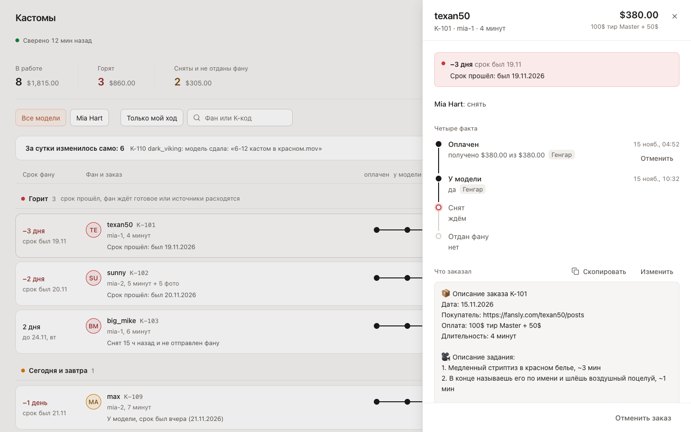

# Кнопка «Кастомы» открывает все заказы кастомов прямо поверх сайта

Внизу кнопок расширения появилась ещё одна, «Кастомы»: на Fansly это последняя строка карточки в левом нижнем углу,
в ChatSpace значок с камерой внизу колонки аккаунтов. Она открывает экран «Кастомы» из Workboard поверх сайта, без
новой вкладки и без пароля: сколько заказов в работе и сколько горит, сроки по каждому, календарь и чей сейчас ход.

Нажмите на заказ, и справа откроется его карточка: четыре факта (оплачен, у модели, снят, отдан), что заказал фан и
шаги, которые вам доступны. Свернуть экран: кнопка «Свернуть» или Esc, открыть снова: та же кнопка «Кастомы». Кнопка
есть у всех, кто вошёл в расширение.

## Как это устроено

Это тот же экран, что в Workboard во вкладке. Он загружается в рамке над сайтом, как доска «Отчёт», а его запросы
идут через расширение с его входом и только к заказам кастомов: список, отданные и закрытые, найденное без заказа,
изменения за сутки, карточка заказа и её шаги. Остальное расширение не пропускает. Hub читает такой вход как вход без
пароля: видны заказы ваших страниц и доступны те же шаги, что в Workboard, открытом из меню расширения (у тех, кто
ведёт кастомы, тоже только свои страницы). «Найдено без заказа» здесь нет: его разбирают в Workboard с паролем. Новый
заказ записывают в панели фана («Записать кастом»). После первого открытия экран остаётся загруженным и при каждом
открытии перечитывает заказы, а при выходе из расширения или входе другим человеком закрывается. Строка «Кастомы»
появляется, только когда Hub при входе говорит, что умеет этот экран, поэтому расширение и Hub выпускаются в любом
порядке.
