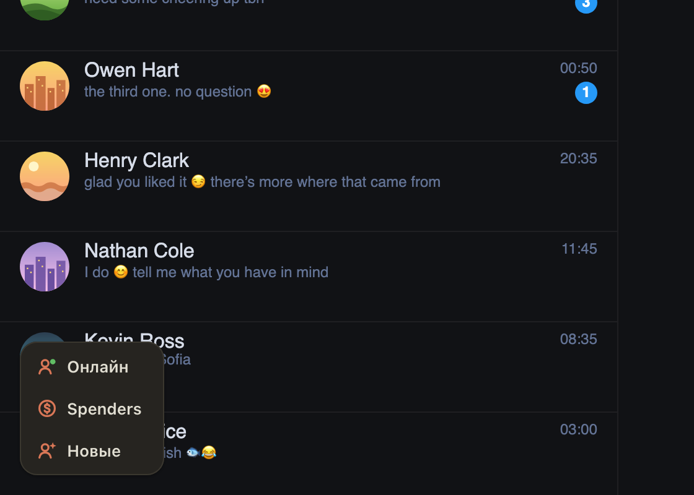

# Кнопки «Онлайн», Spenders и «Новые» на Fansly сразу в цвет страницы

Карточка с кнопками в левом нижнем углу Fansly при загрузке страницы была светлой и темнела только через
несколько секунд, когда открывался чат. На страницах без чата (главная, список сообщений) она так и
оставалась светлой на тёмном Fansly.

Теперь карточка с первого кадра в цвет страницы: тёмная на тёмном Fansly, светлая на светлом, и меняется
вместе с темой сайта.

## Как это устроено

Цвет кнопок задаёт настройка «Тема» в расширении, но её читает основная часть расширения, а она
загружается только в открытом чате или по первому нажатию. До неё карточка была светлой по умолчанию.
Теперь до этого момента карточка берёт тему самой страницы Fansly (по умолчанию «Тема» как раз «как на
сайте»). Если в «Теме» выбрана светлая или тёмная, карточка переходит на неё, как только загрузится
основная часть.
