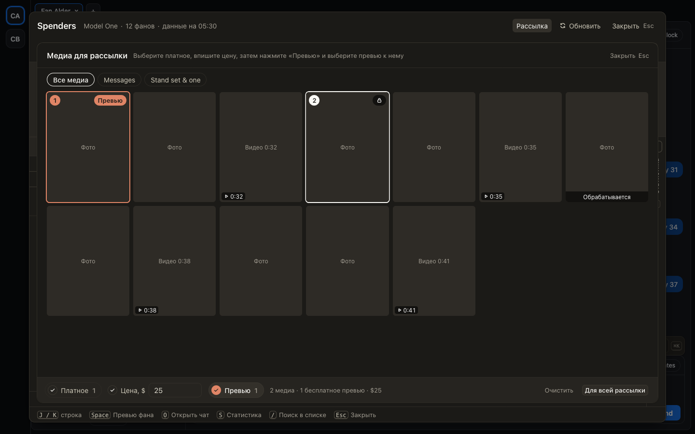

# Медиа из волта: сначала платное, потом цена, потом превью к нему

В окне «Медиа для рассылки» и в панели «Медиа» превью фана было неясно, как выбрать платное и как превью:
медиа кликались подряд, а у превью надо было найти маленькую кнопку «Бесплатно». Теперь внизу три шага.
«Платное»: кликайте медиа, которые фан купит, на них появится замок. «Цена»: впишите сумму. «Превью»:
нажмите его (после цены он подсвечен) и кликните медиа, которое фан увидит бесплатно до покупки. Превью
обведено другим цветом и подписано. Повторный клик снимает выбор, клик по выбранному на другом шаге
переносит медиа туда.

## Как это устроено

Каждое открытие панели начинается с шага «Платное», поэтому бесплатным медиа становится только после
нажатия «Превью». В сообщении превью идёт первым, а платные за ним, каждые в порядке кликов; номера на
плитках показывают этот порядок. Превью имеет смысл только с ценой: в бесплатном сообщении все медиа и так
бесплатны. Платное сообщение, где всё стало превью, по-прежнему не уходит, пока хоть одно медиа не за ценой.
