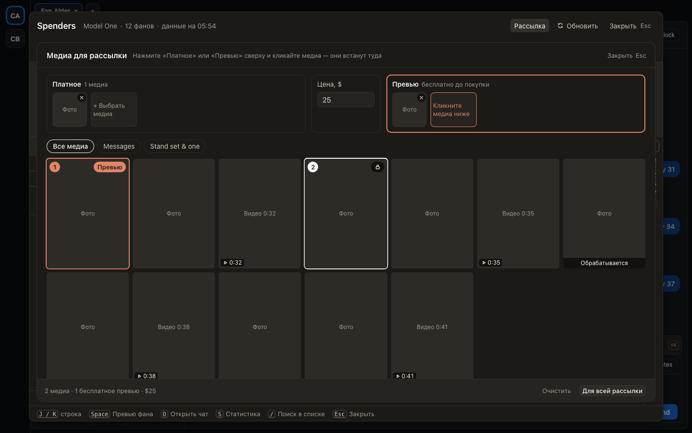

# Медиа из волта: плашки «Платное» и «Превью» сверху

В окне «Медиа для рассылки» и в панели «Медиа» превью фана выбранное теперь видно сверху, в двух плашках:
слева «Платное», справа «Превью», между ними цена. Нажмите на плашку, и следующие клики по медиа в сетке
положат медиа в неё. Медиа в плашке показано миниатюрой, крестик на ней убирает его. Папки волта и сетка
остались под плашками. После платного и цены серый квадратик «+ Выбрать превью» подсвечивается как следующий шаг.

## Как это устроено

Плашки показывают всё выбранное, даже из другой папки. Каждое открытие начинается с «Платного», поэтому
бесплатным медиа становится только после нажатия на «Превью». В сообщении превью идёт первым, платные — за ним.
