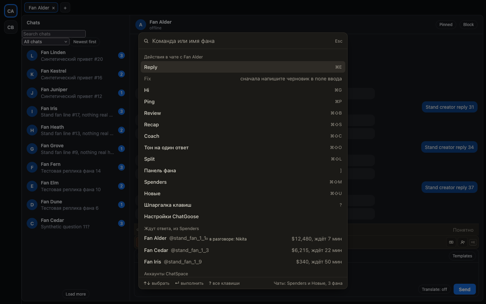
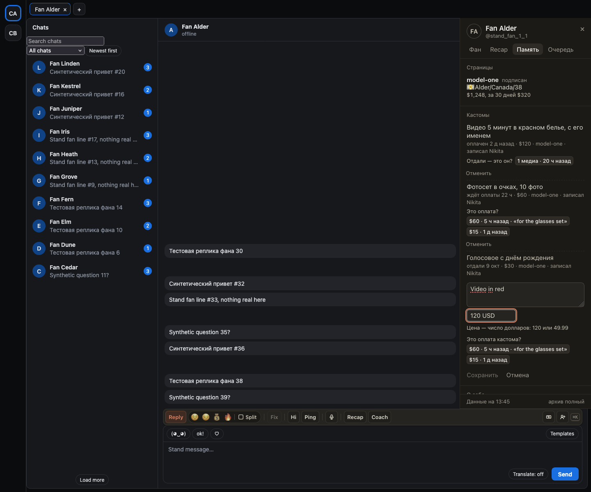

# Кастом сохраняется своему фану, пометка «в разговоре» видна в ⌘K

- Если начать записывать кастом в «Памяти» и переключиться на другой чат, форма закрывается. Раньше кастом мог
  сохраниться другому фану.
- Цену кастома нужно ввести числом долларов: 120 или 49.99. Если ввести иначе, например «120 USD», под полем
  появится подсказка, а «Сохранить» не нажмётся. Раньше кастом сохранялся без цены.
- Пометка «в разговоре: Никита» теперь стоит и в ⌘K, быстром переходе и «Новых» на Fansly.
- Если хаб недолго не отвечает, пометка «в разговоре» уходит через 15 минут после сообщения коллеги, а не позже.
- Удалённый или исправленный факт в «Памяти» больше не возвращается на мгновение, когда карточка перечитывается.
- На Fansly отправка с медиа или PPV записывается за вами, даже если вкладку закрыли сразу после отправки.

## Как это устроено

Действие «Записать кастом» несёт фана, для которого форма открыта; если открыт другой чат, оно ничего не
записывает, а сама форма живёт, пока открыт тот же фан. Цена разбирается строго: доллары и до двух знаков после
точки или запятой, пробелы между тысячами допустимы; всё остальное ценой не считается.

Отправку на Fansly, видную только по ответу сайта, вкладка сразу передаёт фону: он записывает её за тем, кто
вошёл в этот момент, и минуту ждёт, не скажет ли та же отправка, как был написан текст. Раньше вкладка ждала
5 секунд сама, и закрытие вкладки в эти секунды теряло запись.

Отметки «в разговоре» ищутся и по ключу чата без сайта (так их называет ⌘K), и по фану страницы в «Новых» на
Fansly. У каждой отметки свой срок: 15 минут от сообщения коллеги; страницу, которую хаб не ответил, расширение
спрашивает снова через 30 секунд, а не при каждом изменении вкладок. Обзор аккаунтов ChatSpace («/») больше не
закрывает смену: страницы показанных аккаунтов остаются открытыми.
