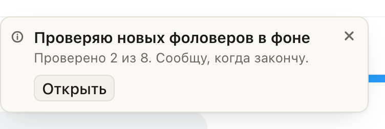
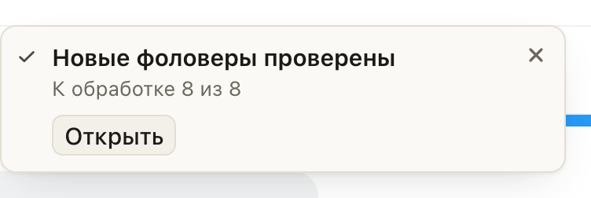

# «Новые» на Fansly проверяют фоловеров дальше, когда окно закрыто

Раньше закрыть «Новые фоловеры» посреди проверки значило поставить её на паузу: она шла дальше только
после того, как окно открывали снова.

Теперь закрывайте окно и работайте в чате: проверка идёт сама, пока открыта вкладка этой модели. Сразу
после закрытия приходит уведомление «Проверяю новых фоловеров в фоне», а когда проверка закончится,
второе: «Новые фоловеры проверены» и сколько фанов к обработке. Если кого-то проверить не удалось, оно
жёлтое: «Проверены не все фоловеры». Оно висит, пока его не закроют. Кнопка «Открыть» возвращает окно
с той же проверкой: все строки, карточка и черновики на месте, а подписавшиеся за это время дочитываются.

## Как это устроено

Проход проверки живёт в фоне расширения. Раньше закрытое окно его останавливало после текущего запроса.
Теперь окно, закрытое человеком, оставляет проход работать за свою вкладку, если проверять ещё есть кого:
вкладка Fansly каждые 10 секунд подаёт фону знак, и он не засыпает. Строки в закрытое окно не отправляются,
а в конце вкладка получает одно уведомление: проверено всё, проверены не все или проверка остановилась
(например, Fansly пять раз подряд не ответил). «Открыть» в последнем случае продолжает проверку оставшихся.
Если окно только открыли посмотреть на законченную проверку и закрыли, уведомлений нет.

Проход останавливается, как и раньше, если вкладку закрыли или в ней открыт другой аккаунт, а также при
смене периода. «Пауза» тоже по-прежнему ставит проверку на паузу, и закрытие окна её не снимает до
следующего открытия. Открытое окно уведомлений о своей проверке не получает: всё видно в нём самом.
