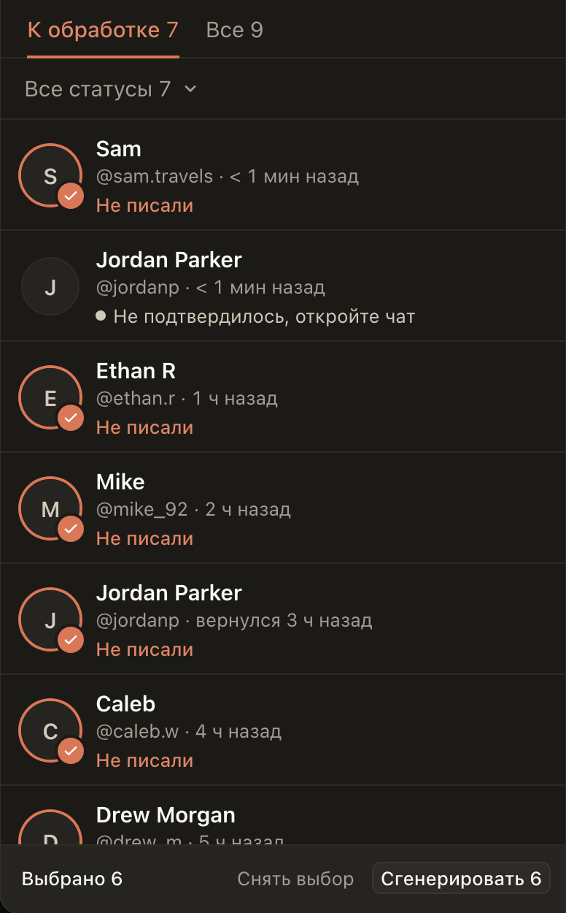

# «Новые»: пакет не здоровается второй раз с фаном, у которого приветствие не подтвердилось

Если приветствие фану ушло с неизвестным итогом, в строке пишется «Не подтвердилось, откройте чат». Раньше после
«Очистить» такой фан снова попадал в «Выбрать N», получал новое приветствие и уходил вместе со всеми по «Отправить
всем», хотя первое могло уже дойти.

Теперь «Выбрать N» его не отмечает, пакет для него не пишет и «Отправить всем» ему ничего не отправляет. Откройте
его чат: если сообщения нет, отправьте ещё раз из карточки фана или кнопкой «Отправить» в его строке.

## Как это устроено

Фан с частью приветствия, итог которой неизвестен, не отмечается в пакете, пакет не запускает для него
генерацию, а «Отправить всем» не отправляет ему ни старый, ни новый текст, даже написанный в карточке через
«Ещё раз». Это то же правило, что уже действует для пакета на Fansly. Свой клик по фану (карточка, «Отправить» в
строке, «Открыть чат») работает как раньше.
