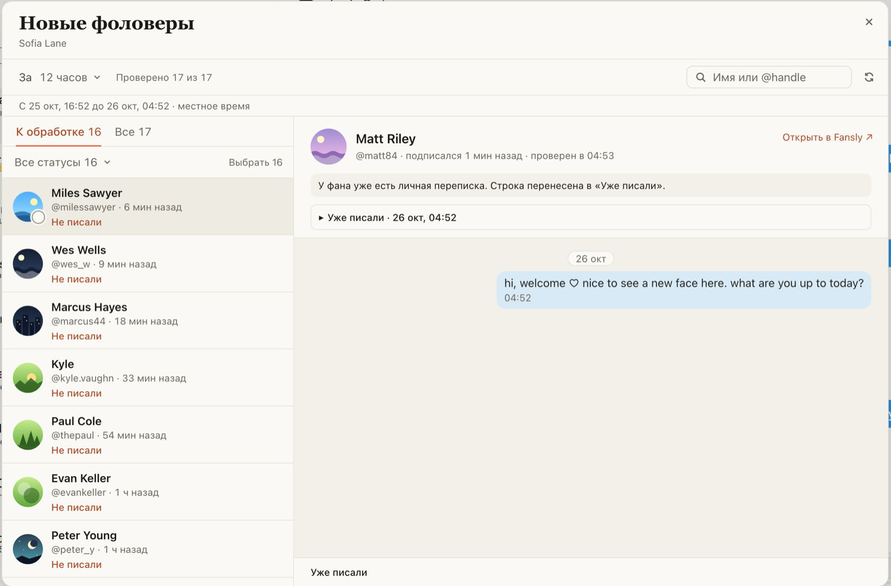

# «Новые» видят, что фану уже написал коллега

Раньше окно «Новые» проверяло чат фана один раз. Если потом фану писал коллега из своего браузера, фан
так и оставался в «Не писали», карточка показывала «Личной переписки ещё нет», а «Сгенерировать» писало
ему второе первое сообщение. Теперь, пока окно открыто, такой фан сам переходит в «Уже писали» в течение
минуты, а в карточке видно сообщение коллеги. Перед «Сгенерировать», для одного фана и для всех сразу,
чат фана тоже читается заново, если проверке больше двух минут: уже поприветствованному фану черновик
не пишется.

## Как это устроено

Пока окно «Новые» открыто, расширение раз в минуту смотрит первую страницу входящих Fansly (один запрос).
Если в чате фана из «Не писали» есть сообщение новее того, что видела проверка, этот чат читается заново
по тем же правилам: личное сообщение модели делает фана «Уже писали», приветствие-автоответ так не
считается. Карточка при открытии и «Сгенерировать» не опираются на проверку старше двух минут. Если
Fansly просит подождать, берётся то, что уже проверено; отправка всё равно перечитывает чат перед
отправкой, как и раньше.
