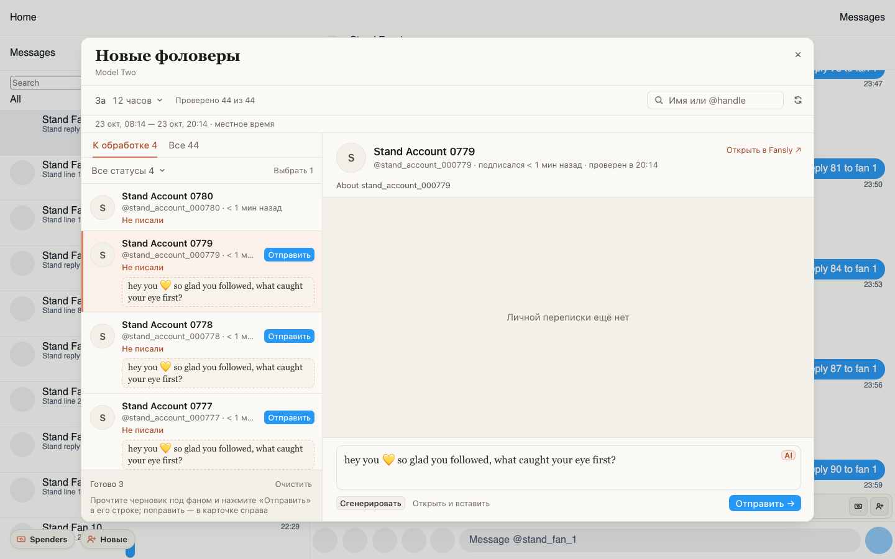

# «Новые» на Fansly помнят проверку и черновики после закрытия окна

Раньше закрыть и снова открыть «Новые фоловеры» значило начать с нуля: все фаны снова вставали
«В очереди», проверка шла заново по одному, а черновики под фанами и «Готово N» пропадали.

Теперь окно открывается таким, каким вы его закрыли: «Не писали» и «Уже писали» на месте, черновики
под фанами и их «Отправить» тоже, карточка открыта на том же фане. Дочитываются только те, кто
подписался, пока окно было закрыто. Они появляются сверху и проверяются. То же при ⟳.

Если перед закрытием вы нажали «Пауза», после открытия проверка тоже продолжится.

## Как это устроено

Проход проверки живёт в фоне расширения. Раньше закрытое окно его отпускало, и следующее открытие
делало новый проход: снова читало переписку каждого фана, о котором не было известно «Уже писали».
Теперь фон отдаёт тот же проход: при открытии он читает новые подписки Fansly (обычно одна страница) с конца
прошлого чтения, сдвигает период к текущему моменту (кто вышел за его начало, уходит из списка)
и проверяет только новых и тех, чья проверка не удалась. Окно, в свою очередь, не стирает строки,
карточку и пачку черновиков при закрытии.

Другой период по-прежнему означает новый проход с полной проверкой. Перед отправкой переписка фана, как и
раньше, читается заново, так что давняя отметка «Не писали» не даст написать тому, кому уже написали.
