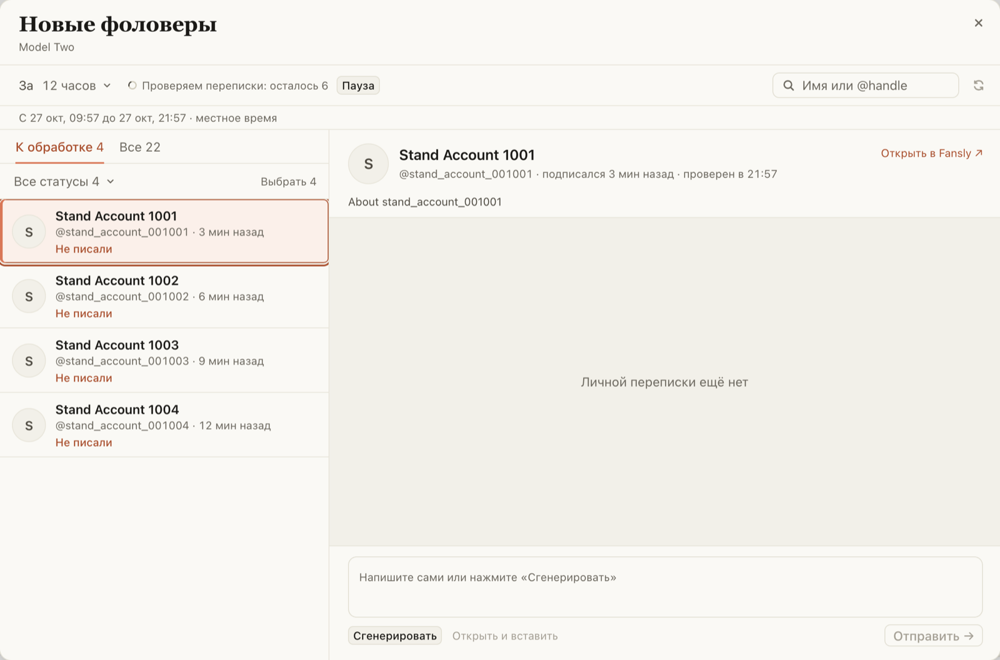

# «Новые» на Fansly: в «К обработке» сразу те, кому ещё не писали

Раньше окно «Новые фоловеры» сначала показывало в «К обработке» всех непроверенных («В очереди»), а потом
их число таяло по мере проверки: 38, 20, 5, 2. Самых свежих фоловеров без переписки проверка брала
последними, а строка «Загружаем фоловеров…» висела, хотя список уже был на экране. После перезагрузки
вкладки окно иногда открывалось с ошибкой, и нужно было нажимать «Повторить».

Теперь:

- в «К обработке» попадают только проверенные фаны, с которыми есть что делать, и список растёт сверху
  вниз; пока никого не нашли, окно так и пишет: «Ищем, кому ещё не писали»;
- проверка идёт от самых новых фоловеров к старым, а тех, кому уже писали, отсеивает сразу;
- над списком одна строка: «Проверяем переписки: осталось N», «Пауза» на месте;
- после перезагрузки вкладки окно само дожидается Fansly, «Повторить» не нужно.

Все фоловеры периода, вместе с ещё не проверенными, по-прежнему во вкладке «Все».

## Как это устроено

Проверка читает список фоловеров и начало входящих. Чат, где последнее сообщение личное от модели, сразу
отмечается «Уже писали», без запросов. Остальные фаны проверяются в одной очереди от новых к старым: по
чату из входящих, а если чата нет, Fansly создаёт пустой (как и раньше). Раньше сначала шли все фаны с
чатом во входящих, а фаны без чата ждали конца. Профили (ваше имя для фана, аватар, «о себе») читаются
между проверками, когда Fansly это разрешает (раз в 5 секунд), а не останавливают очередь. Если после
загрузки страницы у расширения ещё нет сессии Fansly, проверка ждёт её до 20 секунд, а не падает.
