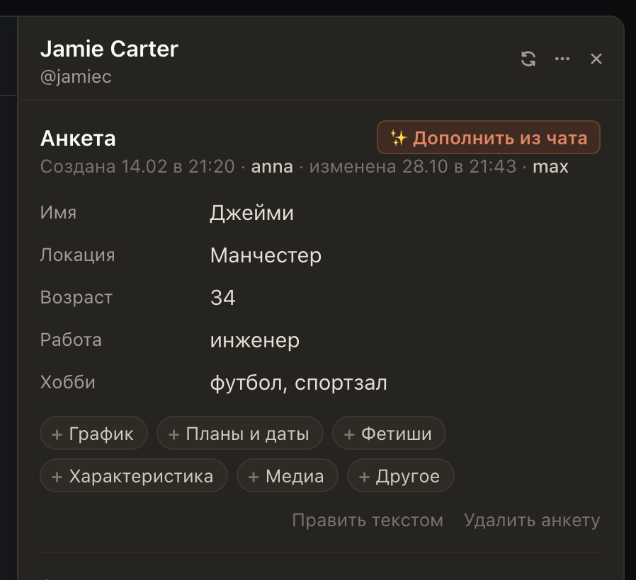

# Под анкетой видно, кто её создал и кто менял последним

Раньше анкета была без подписи, и было непонятно, кто из смены её завёл и кто правил. Теперь под заголовком
«Анкета» строка: когда она создана и кем, когда изменена последний раз и кем. Ваши правки подписаны «вы».

## Как это устроено

Даты берутся из самих заметок (Монстра или Fansly). Имена берутся из хаба: каждая запись через «Заметки»
(поле, «✨ Дополнить из чата», правка текстом, перенос со старого аккаунта) сообщается хабу с вашим логином, без
текста. На Fansly хаб записывает это с 27.10, на OnlyFans с этого выпуска. Анкета, созданная раньше или в окне
самого Монстра или Fansly, показывает только дату, без имени.
