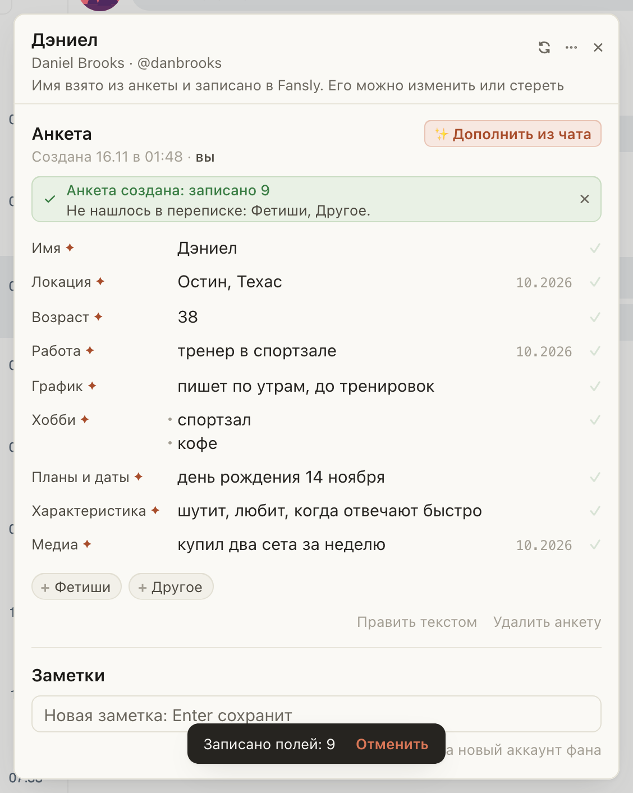

# Имя из анкеты само становится именем фана на Fansly

Раньше имя фана вписывали дважды: в анкету и отдельно в «Имя для себя», чтобы оно стояло в чатах Fansly. Теперь,
когда вы записываете анкету (галочка у подсказки Гуся, «Принять все» или поле вручную), из неё сразу собирается
имя для себя, как его пишет команда: Имя/Страна/Возраст, например «Dan/US/38». Под шапкой заметок появится строка
«Имя взято из анкеты». Если у фана уже есть своё имя для себя, оно остаётся как было. Не подошло: исправьте или
сотрите имя в шапке заметок, как раньше.

## Как это устроено

Имя: первое слово поля «Имя», без даты и пояснений в скобках («George (Petri George)» даст George). Фраза вместо
имени («не называет, просит звать по нику») имени не даёт. Имя пишется как в анкете: если там «Эван», будет «Эван».
Страна: из «Локации», по-английски: «Германия» станет Germany, «США», штаты и большие города США станут US,
«Великобритания» станет UK. Место, которого нет в списке, пишется как в анкете («Baku»). Возраст: число из
«Возраста»; «средних лет» или «25-30» пропускаются. Чего в анкете нет, того нет и в имени: «Sam/US», «Sam/30».

Имя пишется только вместе с вашей записью анкеты: открытие чата или заметок ничего не меняет. Имя, которое
поставила сама анкета, дополняется вместе с ней: было «Dan», Гусь нашёл страну, станет «Dan/US». Имя, вписанное
иначе (с метками вроде 💵 или ✅, другое имя), не трогается. Если вы в этот момент сами печатаете имя в шапке,
остаётся ваше. «Отменить» после галочки возвращает имя, каким оно было до неё. В списке чатов и в шапке самого
Fansly новое имя видно после обновления страницы, как и при записи имени вручную. На OnlyFans имени для себя в
заметках нет, там ничего не меняется.
