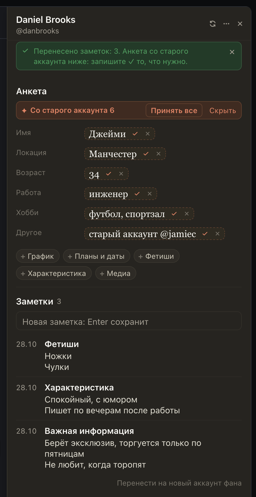

# Заметки фана переносятся со старого аккаунта на новый

Фан пишет с нового аккаунта («тот сломался», «удалил акк»), а заметок у него нет: и Монстр, и Fansly хранят заметки
отдельно для каждого аккаунта. Теперь их можно перенести в два нажатия:

- в чате старого аккаунта, в «Заметках» внизу: «Перенести на новый аккаунт фана»;
- в чате нового аккаунта, в «Заметках» сверху будет «Заметки с аккаунта @…»: «Вставить сюда».

Заметки появятся у нового аккаунта, а анкета встанет подсказками прямо в строки: запишите ✓ то, что нужно, или
«Принять все». В «Другое» предложится строка «старый аккаунт @…», чтобы команда видела связь.

## Как это устроено

Копия живёт только в этой вкладке и только до вставки (или до «Отмена» / «Не переносить»), никуда не отправляется.
Вставить её можно в чат того же аккаунта модели. Заметка, которая у нового аккаунта уже есть с тем же заголовком и
текстом, второй раз не пишется; заметки FBuddy и слишком длинные остаются на старом аккаунте. Анкета не
переписывается целиком: в строки идут только те факты, которых у нового аккаунта ещё нет, и каждый записывается
вашим ✓, как подсказки «Дополнить из чата». Если запись заметки оборвалась, нажмите «Обновить», потом «Вставить
сюда» ещё раз: перенесённые не повторятся. Дата у перенесённых заметок сегодняшняя.
