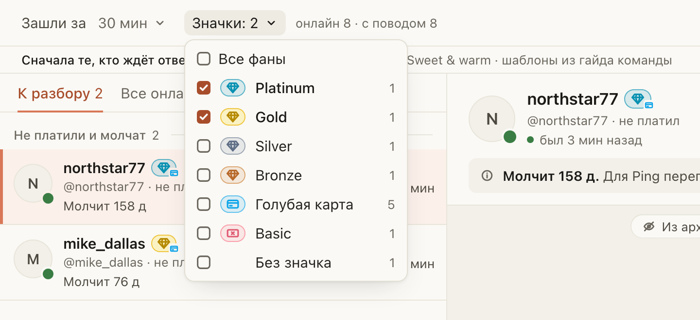

# «Онлайн» на Fansly показывает только тех, кого вы отметили по значкам

Для чаттеров Fansly: когда онлайн больше сотни фанов, легко потратить время на тех, кто нигде не платит. Рядом с
«Зашли за» появилась кнопка «Значки». В ней галочки: Platinum, Gold, Silver, Bronze, голубая карта, Basic и «Без
значка», у каждой видно, сколько таких фанов во вкладке.

Поставьте галочки, и в списке останутся только эти фаны, в каждой группе сверху самый дорогой значок. Если галочек
несколько, в списке фаны хотя бы с одной из них: Gold и голубая карта покажут и тех, и других. Следующая карточка
после отправки тоже откроется из отмеченных. «Все фаны» снимает галочки. Они живут, пока открыта вкладка.

## Как это устроено

Значки те же, что в строках «Онлайн»: алмазики приходят из FBuddy, голубая карта из Fansly. Пока значки фана не
пришли, он считается «Без значка». Если FBuddy не подключён в этом Firefox, работает только голубая карта, а внизу
окна написано, что сделать. Счётчик «онлайн · с поводом» в шапке всегда про всех фанов, счётчики вкладок про
отмеченных. Другие цветные карты Fansly (бронзовая, серебряная, жёлтая, фиолетовая) сервер Fansly сейчас не отдаёт,
поэтому галочек для них нет.
