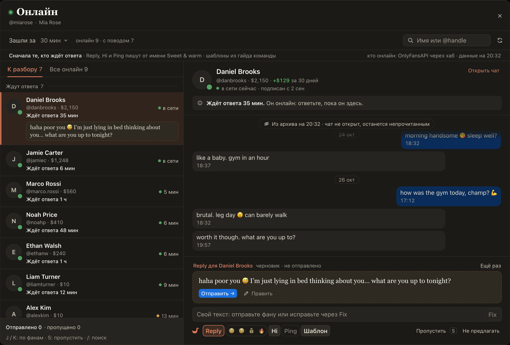

# «Онлайн»: низ карточки как в чате Spenders, со своим текстом и Fix

Низ карточки фана в «Онлайн» теперь устроен как чат в Spenders. Поле «Свой текст» с Fix, под ним привычная полоска:
Reply с настроениями, Hi, Ping и «Шаблон». Как и раньше, ничего не пишется, пока вы не нажмёте кнопку. Над полем
сказано, что советуем этому фану, а если AI для него писать не может (на Fansly с ним ещё нет чата), то почему.
Готовый текст встаёт над полем: под ним «Отправить →» и «Править», справа «Ещё раз». Свой текст можно отправить
как есть или нажать Fix: AI перепишет его для этого фана, и он встанет над полем. «Пропустить» и «Не предлагать»
теперь справа от кнопок, J / K и S работают как раньше.

## Как это устроено

Reply, Hi, Ping и Fix пишут текст по одному запросу на нажатие; настроение для Reply выбирается в капсуле рядом, как в
доке. «Свой текст» общий с карточкой фана в Spenders: это один черновик. Свой текст уходит тем же путём, что и
«Отправить →» карточки: одно сообщение по клику, он попадает в счёт «Отправлено» и в отчёт хаба. Если у карточки есть
предупреждение (архив не проверен, с фаном говорит коллега), свой текст встаёт над полем и ждёт «Отправить всё равно».
