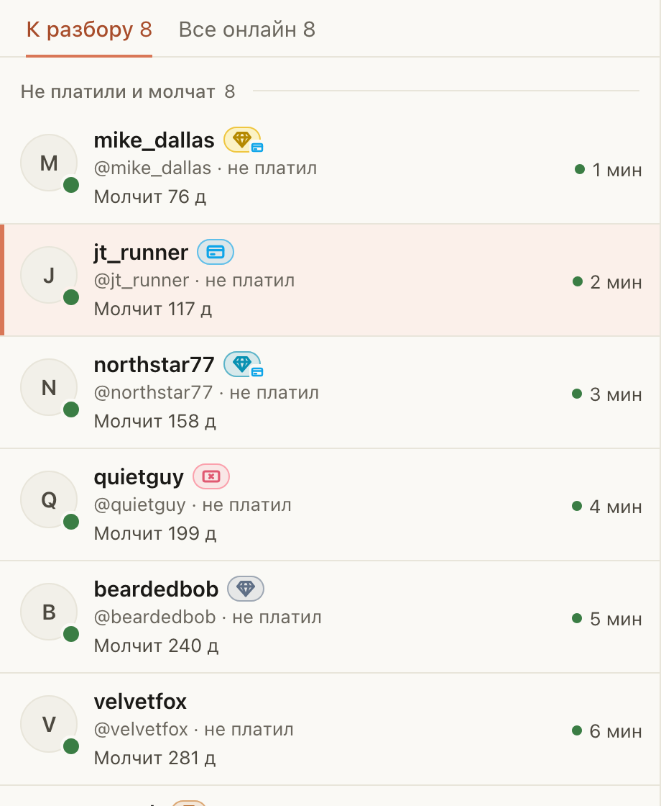

# «Онлайн» на Fansly показывает алмазики FBuddy и голубую карту

Для чаттеров Fansly, которые выбирают, кому из зашедших фанов написать первым. Рядом с именем фана теперь те же
значки, что рисует FBuddy:

- алмазик цвета уровня FBuddy: Bronze (до $100), Silver (до $1000), Gold (до $3000), Platinum (больше): сколько фан
  потратил у всех моделей, не только у нашей;
- голубая карта Fansly: фан недавно платил на Fansly. Если есть алмазик, карта стоит у него в уголке;
- красная купюра: Basic, фан нигде не тратил.

Ничего включать не нужно: значки появляются сами. Для алмазиков нужно только быть залогиненным в FBuddy в этом
Firefox, как обычно. Если внизу окна «Онлайн» написано «Алмазикам FBuddy нужно разрешение», нажмите «Включить»,
затем «Разрешить FBuddy» на карточке Fansly в настройках и подтвердите в окне Firefox: это один раз. Наведите на
значок: подсказка скажет уровень словами.

## Как это устроено

Голубую карту ChatGoose читает у Fansly в сессии модели: это флаг «Recent Spender» аккаунта фана, тот же, что
показывают FBuddy и сам Fansly. Каждого фана спрашивает не чаще раза в 10 минут.

Уровень FBuddy считает по своей базе: суммы трат фана у всех моделей, чьи данные есть у FBuddy. ChatGoose берёт
его у FBuddy так же, как это делает расширение FBuddy: из этого Firefox, под вашим входом в FBuddy, тоже не чаще
раза в 10 минут на фана. В FBuddy уходят только номера модели и фанов, ничего не пишется.

Доступ к FBuddy расширение получает при установке. Firefox не выдаёт новый доступ при обновлении сам, поэтому у
кого ChatGoose уже стоял, ему может понадобиться одно «Разрешить FBuddy».

Если вы не вошли в FBuddy в этом Firefox, внизу окна будет подсказка войти. Фан без уровня в базе FBuddy
остаётся без алмазика. На OnlyFans значков нет: это значки Fansly и FBuddy.
