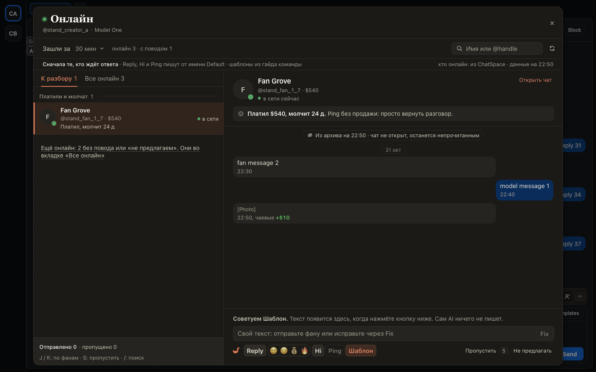
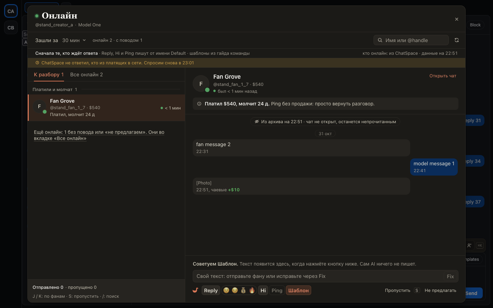

# «Онлайн» на OnlyFans узнаёт, кто в сети, из самого ChatSpace

С 1 ноября агентство отключает OnlyFansAPI, через который хаб узнавал, кто из фанов OnlyFans в сети. Теперь окно «Онлайн» и число «Онлайн N» на панели берут это из самого ChatSpace: из зелёных точек в списке чатов и в открытом чате. Пока у кого-то из команды открыт ChatSpace, список пополняется сам, работать можно как раньше.

Если ChatSpace не ответил, кто из платящих фанов в сети, окно скажет об этом строкой под заголовком и напишет, когда спросит снова.

## Как это устроено

Вкладка раз в минуту смотрит в памяти ChatSpace, кого его собственный опрос нашёл в сети (ChatSpace сам спрашивает о видимых чатах раз в 5 минут), и сообщает хабу. Лишних запросов к OnlyFans это не добавляет.

Где владелец включил проверку платящих (`onlineProbe`), хаб раз в 5 минут даёт одной вкладке всей команды до 400 известных ему спендеров страницы, и она один раз спрашивает ChatSpace, кто из них в сети, тем же запросом, что и сам ChatSpace. Только на видимой вкладке и без повторов: после ошибки или «не успел» вкладка ждёт 10, потом 20 и 40 минут.

Фаны, которых хаб ещё не знает (подписались после отключения OnlyFansAPI), в списке пока не появляются.
