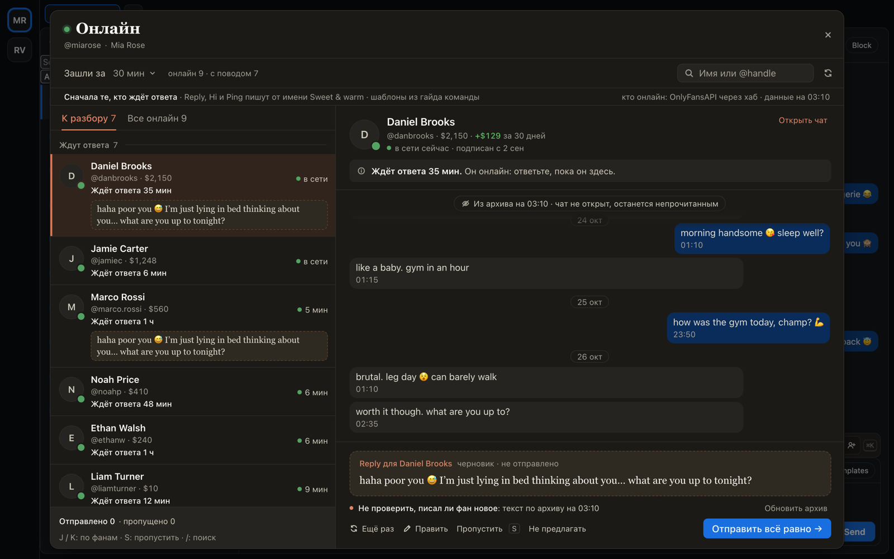
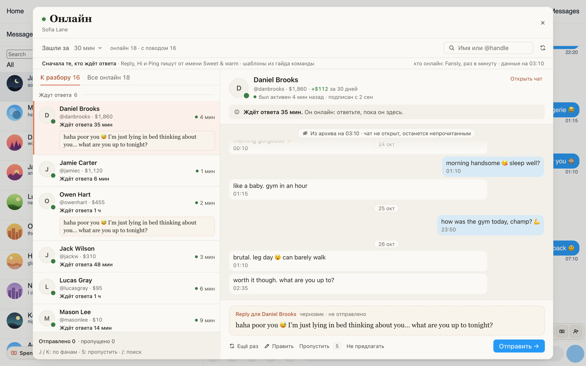

# «Онлайн»: кому из фанов в сети написать прямо сейчас

Для всех чаттеров. Кнопка «Онлайн» у поля ввода (рядом число фанов, которым сейчас есть повод написать) или ⌘K →
«Онлайн» открывает окно с фанами страницы, которые зашли за последние 30 минут (можно 10 минут или 2 часа). Они
разложены по поводу: ждут ответа, новые без привета, кончается подписка, платили и молчат, ни разу не писали.
Справа карточка фана: почему писать сейчас, его переписка (чат не открывается и остаётся непрочитанным) и готовый
текст: Reply, Hi или Ping от AI, а тем, кто ни разу не писал, шаблон из гайда команды с его именем вместо «love».
«Отправить →» отправляет одно сообщение и открывает следующего фана. «Пропустить» (S) убирает фана из этого
прохода, «Не предлагать» убирает его для всей команды.

## Как это устроено

Список собирает хаб. На OnlyFans он узнаёт, кто в сети, от OnlyFansAPI; «вышел» оттуда приходит примерно через
полчаса, поэтому в окне написано «зашёл N мин назад», а «в сети» стоит только у тех, кого в сети показывает сам
ChatSpace. На Fansly расширение раз в минуту, пока открыта вкладка, читает, кто из подписчиков был активен (как
FBuddy), и передаёт хабу. Повод и текст решает хаб: Reply тому, кто ждёт, Hi новичку, Ping, если в переписке не
меньше 10 сообщений, шаблон A, если переписка короче, шаблон B, если фан не писал ни разу. Фаны, которым недавно
писали, отмеченные «не предлагать» и те, с кем сейчас переписывается коллега, лежат во вкладке «Все онлайн»:
написать им можно, окно предупредит. AI пишет текст только для открытой карточки и следующей. Отправка как в
«Рассылке»: в ChatSpace кнопкой карточки, на Fansly через расширение; одно нажатие, одно сообщение, повторов
само не делает.
