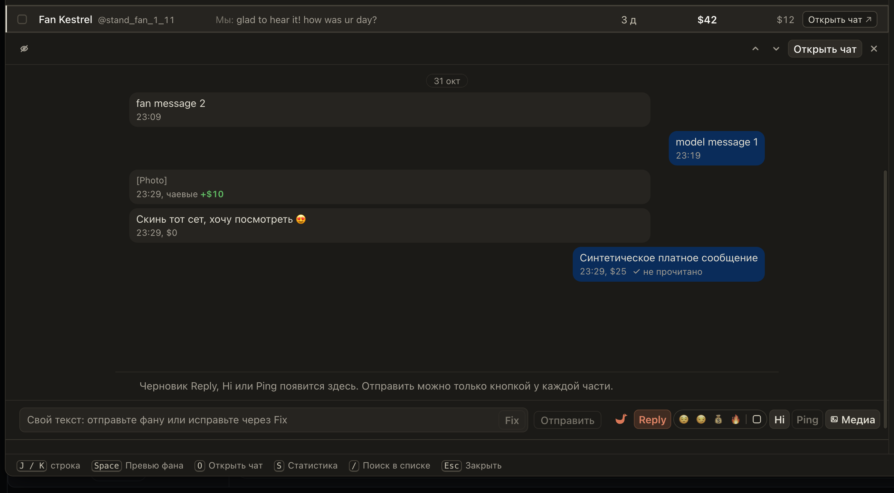

# Spenders, превью и «Ждут ответа» на OnlyFans снова видят новые сообщения

С 1 ноября OnlyFans закрыл доступ сервису, откуда мы брали переписки, покупки и подписки. Без него Spenders,
превью фанов, «Ждут ответа», Recap, «Память» и ответы Reply перестали бы видеть новое. Теперь их наполняет
само расширение: то, что ChatSpace уже показывает вам, оно передаёт агентству. Новые сообщения, покупки PPV
и чаевые появляются в превью и в ответах через несколько секунд.

Делать ничего не нужно: держите ChatSpace открытым, как обычно. Чем больше чатов вы открываете и листаете,
тем полнее история у остальной команды.

## Как это устроено

Расширение не делает своих запросов ни к OnlyFans, ни к OnlyMonster. Оно берёт только то, что ChatSpace уже
получил сам: из его соединения новые сообщения в обе стороны, удаления, покупки и чаевые; из его собственных
загрузок страницы истории открытого чата, список чатов, карточки фанов и вкладку продаж, когда вы её
открываете. Всё это уходит на сервер агентства под вашим входом. Одно и то же из разных вкладок и от разных
чаттеров записывается один раз, а покупка, которую видно и в соединении, и во вкладке продаж, считается одной.
Тексты сообщений попадают туда же, куда раньше: в архив, по которому строятся превью, Reply, Coach и Recap.
Владелец может выключить это отдельным переключателем для каждой страницы.
