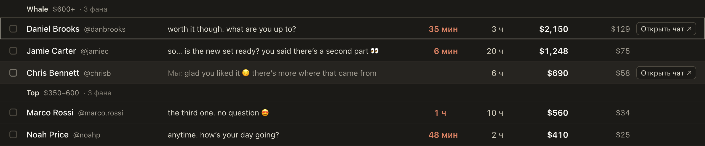

# «Открыть чат» с ⌘ или Ctrl открывает чат в новой вкладке

Раньше клик по «Открыть чат» с зажатым ⌘ (в Windows Ctrl) работал как обычный: чат открывался в этой же вкладке, а окно
закрывалось, и работа в нём прерывалась. Теперь с ⌘ или Ctrl чат открывается в новой вкладке рядом, а вы остаётесь на
месте, с тем же окном и списком. Так можно открыть несколько чатов подряд.

Работает в Spenders, превью фана, «Рассылке», «Онлайн», «Очередях», «Новых», в уведомлениях и в панели фана. Обычный клик
работает как раньше.

## Как это устроено

Кнопка смотрит, зажат ли ⌘ или Ctrl во время клика. Если зажат, расширение открывает адрес чата этого сайта в фоновой вкладке
сразу за текущей, а в текущей ничего не двигается: ни адрес, ни открытые окна. Чат, как и при обычном клике, становится
прочитанным, когда новая вкладка его откроет, поэтому каждая такая вкладка открывается только по вашему клику.
