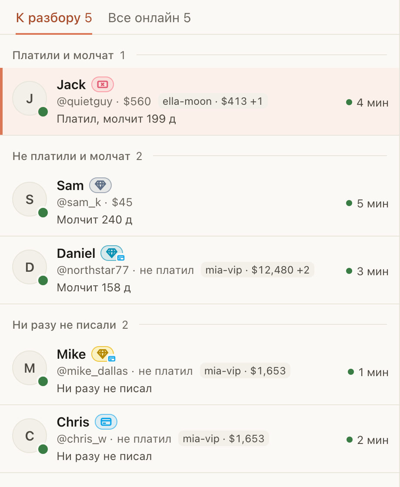

# «Онлайн» и «Новые» показывают, сколько фан потратил на других страницах

Для чаттеров, которые пишут зашедшим и новым фанам. Фан, который платит на одной странице агентства, часто просто
подписан на другую и там выглядит холодным. Теперь в строке такого фана рядом с ником видно, где и сколько он
потратил: `mia-vip · $1,653`. Если страниц несколько, показана самая крупная и «+1»; наведите на метку, и подсказка
покажет все страницы с суммами.

Где это видно:

- «Онлайн» на OnlyFans и на Fansly;
- «Новые» на OnlyFans;
- шапка открытого чата на Fansly: нажмите на метку, откроется список страниц.

Это подсказка, а не предупреждение: метка ничего не запрещает, включать ничего не нужно. Просто не пишите такому фану
как незнакомому.

## Как это устроено

Суммы приходят вместе со списками, которые расширение и так загружает: отдельного запроса нет, страницы не становятся
медленнее. Считаются все другие страницы агентства на той же площадке, в том числе других моделей и те, где вы не
работаете. Видны только название страницы и сумма за всё время: сообщения и факты с другой страницы сюда не попадают.

В «Новых» на Fansly метки нет: этот список расширение собирает из самого Fansly, и суммы хаба к нему не приходят.
В шапке чата на OnlyFans метки тоже нет: при открытии чата там нет подходящего ответа хаба.
