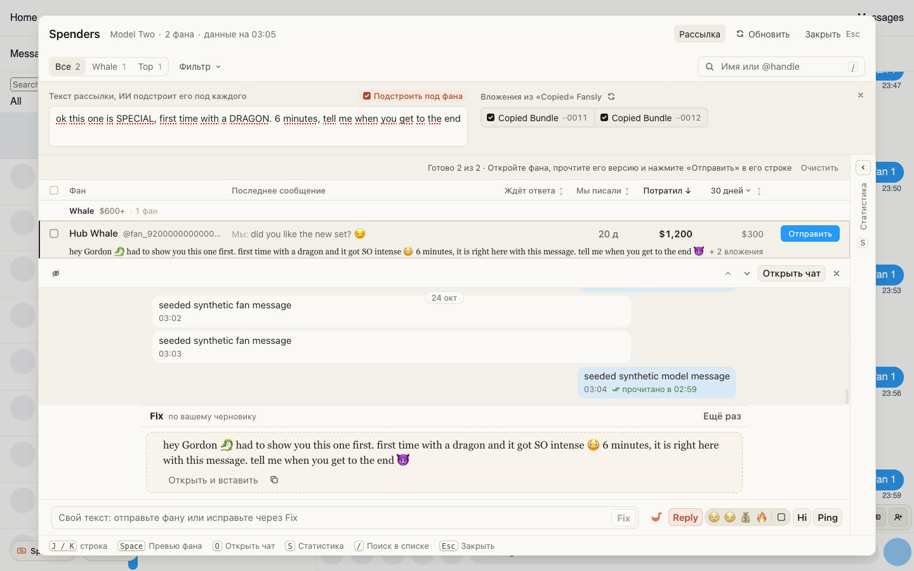

# Рассылка китам: ИИ подстраивает текст рассылки под каждого фана

В «Рассылке» Spenders появилась галочка «Подстроить под фана», она включена сразу. Пишете текст как для
обычной массовой рассылки, а ИИ переписывает его под каждого отмеченного фана: по имени и по вашей
переписке, где это уместно, менее продажно и не так массово. Каждому уходит своя цельная версия, без
шва между личной строкой и общим текстом, и вместе с ней бандлы поста.

- Напишите текст рассылки и отметьте фанов.
- Нажмите «Подстроить под каждого». Под фаном видно начало его версии, целиком она в превью фана.
- Прочтите и нажмите «Отправить» в строке фана.

Снимите галочку, и будет как раньше: личная строка от Reply или Ping, под ней общий текст.

## Как это устроено

Версию пишет Fix по тексту рассылки с отдельным заданием для рассылки. Оно живёт в хабе: текст общий
для многих фанов, его надо сделать личным для этого фана, все факты о видео сохранить, не отправлять
к посту и не называть цену, потому что видео уже прикреплено к сообщению. Черновик в превью фана при
этом не меняется. Если хаб ещё не умеет так переписывать, галочки нет.
