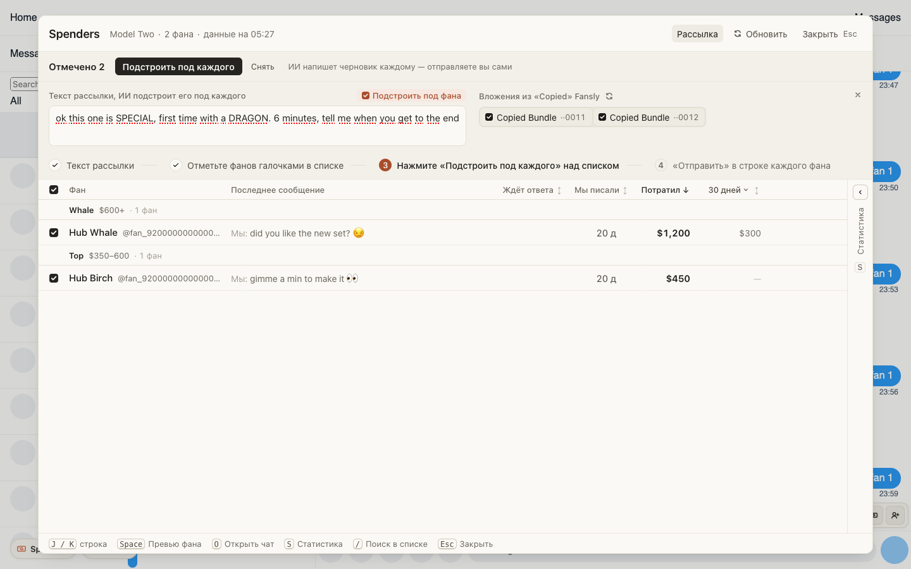

# Рассылка на Fansly снова отправляет бандлы поста, и фан их получает

Скопированные в посте бандлы иногда показывались в «Рассылке» как Copied Media, а после отправки фану
приходил только текст, без медиа. Виноват сам Fansly: после любой перезагрузки его вкладки он
переписывает скопированные бандлы в список медиа. Теперь «Рассылка» спрашивает у Fansly, что из
скопированного на самом деле бандл, и показывает и отправляет их как Copied Bundle. Галочки на них
стоят сразу.

Если Fansly не ответил, под списком появится предупреждение. Тогда нажмите «Обновить список» рядом
с «Вложения из «Copied» Fansly».

## Как это устроено

Fansly хранит скопированное в `localStorage` (`media_service_copied_media`) двумя списками: медиа и
бандлы. При загрузке вкладки его собственный код кладёт id из обоих списков в список медиа, а список
бандлов очищает. Вкладки к тому же перезаписывают список друг друга, поэтому один и тот же id то
бандл, то медиа. Бандл, отправленный с типом медиа (`contentType: 1`), Fansly принимает, но фан ничего
не получает.

Когда «Рассылка» открывается или вы нажимаете «Обновить список», id из списка медиа один раз уходят
в `GET /account/media/bundle?ids=`: это тот же запрос, которым Fansly сам загружает бандлы. Те id,
что Fansly вернул как бандлы, уходят в сообщении с `contentType: 2`. Если ответа нет (Fansly
притормаживает запросы, сеть), список остаётся как есть и под ним стоит предупреждение. Сам список
Fansly мы не меняем.
