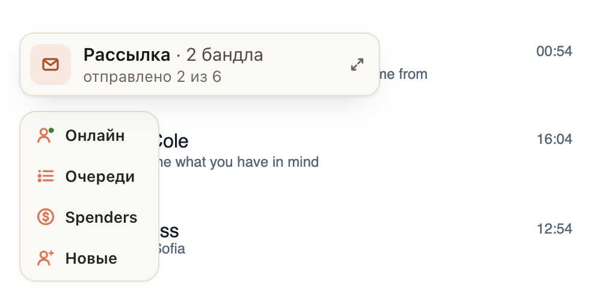

# Свёрнутая «Рассылка» стоит над карточкой в углу и не закрывает «Онлайн»

После «Свернуть» плашка «Рассылки» в левом нижнем углу ложилась на карточку с кнопками «Онлайн», «Очереди»,
Spenders и «Новые» и закрывала «Онлайн». У кого в карточке есть «Отчёт» и пока внизу страницы стоит полоса
отчёта, она закрывала ещё больше. Теперь плашка стоит над карточкой с небольшим зазором, какой бы высоты карточка
ни была, и все её кнопки видны и нажимаются.

## Как это устроено

Плашка стояла на постоянной высоте, рассчитанной на карточку из трёх строк. С тех пор карточка выросла: «Очереди»
добавили четвёртую строку, «Отчёт» пятую, а пока внизу страницы стоит полоса отчёта, карточка поднимается над ней.
Теперь расширение измеряет, где на самом деле верх карточки, и ставит плашку на 12 пикселей выше. Место
пересчитывается, когда в карточке появляется или пропадает строка и когда карточка поднимается или опускается.
