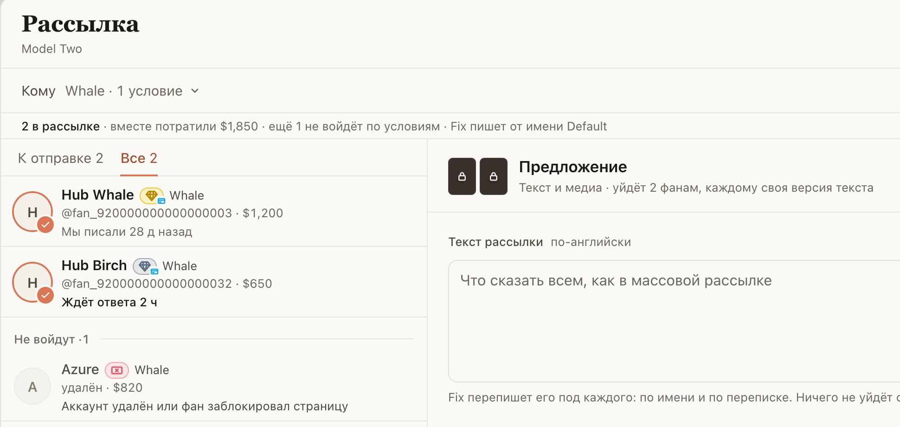
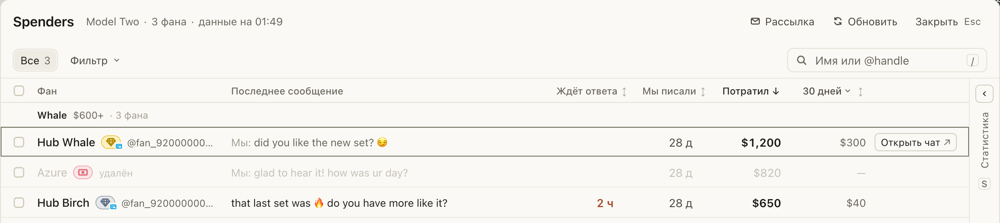

# Удалённые аккаунты помечены в Spenders и не попадают в рассылку

Фан, который удалил аккаунт или заблокировал страницу, выглядел в Spenders и в «Рассылке» как обычный. Ему
писалась версия, отправка заканчивалась «Не подтвердилось», а «Открыть чат» никуда не вёл.

Теперь в Spenders такой фан серый, с пометкой «удалён» вместо @ника. В «Рассылке» он сразу стоит в «Не войдут»
с причиной, а в «Кому» появляется условие «Без удалённых аккаунтов» (оно включено). Если всё же нужно написать
этому фану, снимите галочку.

## Как это устроено

Хаб проверяет фанов страницы через Fansly. Если последняя проверка через эту страницу фана не нашла (аккаунт
удалён или страница у него в блоке), хаб отдаёт время этой проверки в списке Spenders, и расширение помечает
фана. Когда очередная проверка его найдёт, пометка уйдёт сама. Условие «Без удалённых аккаунтов» видно, только
пока среди выбранных фанов есть такой.
