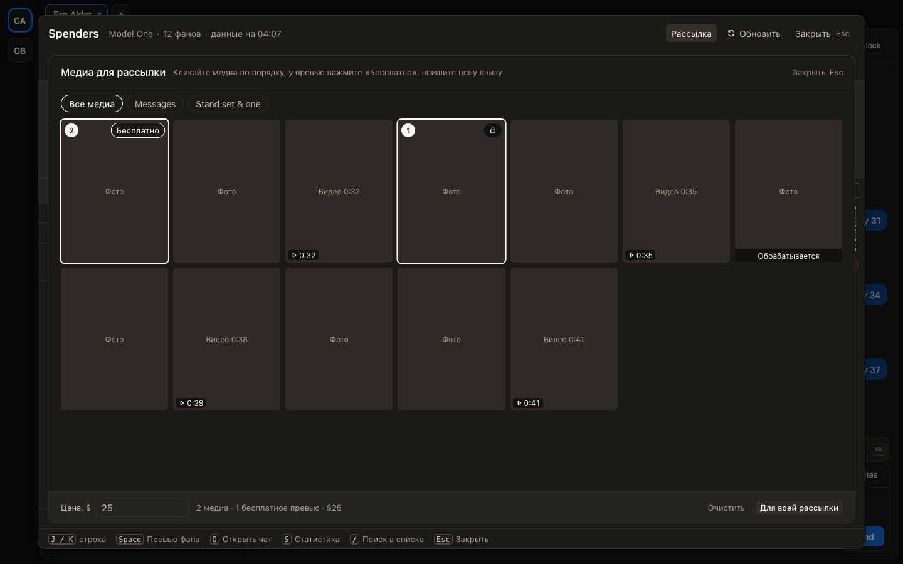

# Рассылка: медиа выбираются в отдельном окне, а шаги показывают, что нажать дальше

В ChatSpace медиа для рассылки выбирались в узкой полосе под строкой фана: её трудно найти и неудобно листать.
Теперь «Выбрать медиа» в панели рассылки открывает отдельное окно со всеми папками волта, крупной сеткой и ценой
внизу. Кликайте медиа по порядку, у превью нажмите «Бесплатно», впишите цену и нажмите «Для всей рассылки».
Esc закрывает окно, «Изменить» открывает его снова с теми же отметками.

Под текстом рассылки на обоих сайтах видно четыре шага: текст, галочки у фанов в списке, «Подстроить под каждого»
над списком и «Отправить» в строке каждого фана. Текущий шаг подсвечен.

## Как это устроено

Окно работает как выбор медиа в превью фана, только без привязки к фану: отметки, бесплатные превью и цена уходят
всем фанам рассылки, у кого в превью нет своего выбора. Пока проверяются отметки соавторов, сетка остаётся на
месте. Шаги считаются по состоянию рассылки: есть ли текст, отмечены ли фаны, начата ли подстройка, готовы ли
версии. Без «Подстроить под фана» на Fansly общий текст необязателен, и шаг с текстом не держит остальные.
