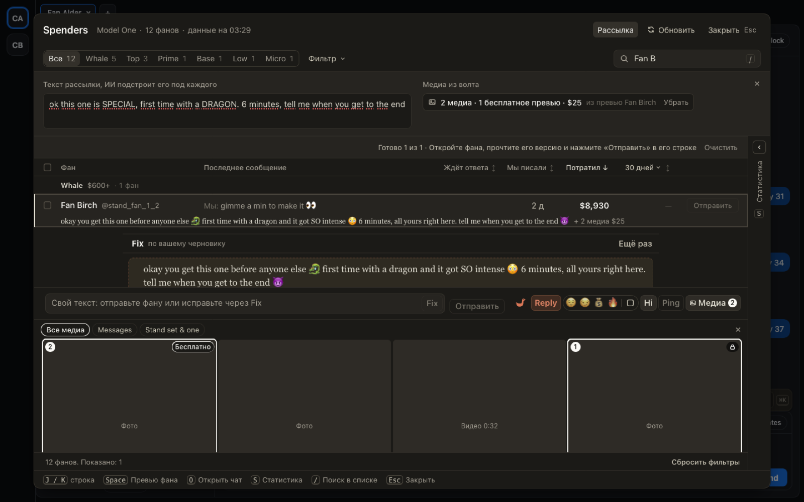

# Рассылка китам на OnlyFans: каждому своя версия текста и медиа из волта с ценой

Для чаттеров OnlyFans, когда новый PPV нужно предложить крупным фанам лично. В Spenders появилась
«Рассылка»: пишете текст как для массовой рассылки, ИИ переписывает его под каждого отмеченного фана,
и каждому уходит его версия вместе с медиа из волта по одной цене.

- Нажмите «Рассылка» и напишите текст рассылки.
- Отметьте фанов и нажмите «Подстроить под каждого». Под фаном начало его версии, целиком она в превью.
- В превью любого фана откройте «Медиа», выберите видео и бесплатное превью, укажите цену и нажмите
  «Для всей рассылки». Эти медиа и цена уйдут всем отмеченным фанам, у кого нет своего выбора.
- Нажмите «Отправить» в строке фана. Если ИИ писал с закрытым чатом, кнопка предупредит
  «Отправить всё равно»: перед отправкой можно посмотреть переписку в превью.

Кому медиа не подходят (например, ролик снят на заказ для него), снимите отметку или выберите ему в
превью другое.

## Как это устроено

Версию пишет Fix по тексту рассылки с заданием рассылки из хаба. Отправка та же, что у «Отправить» в
превью: через очередь ChatSpace, с опекой хаба и записью, кто отправил. Медиа рассылки копируются в
выбор медиа каждого фана, поэтому в превью видно, что уйдёт и что фан уже покупал. Свой выбор фана
рассылка не трогает. Одна кнопка отправляет одно сообщение, повтора нет.
