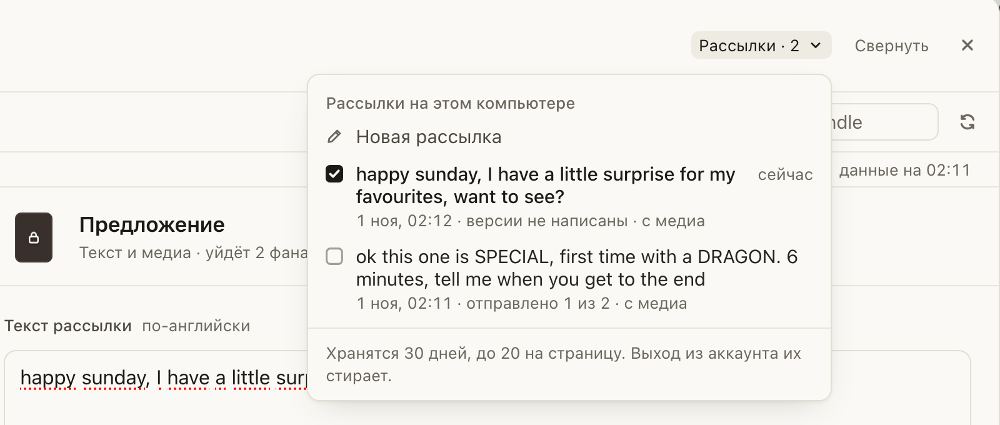
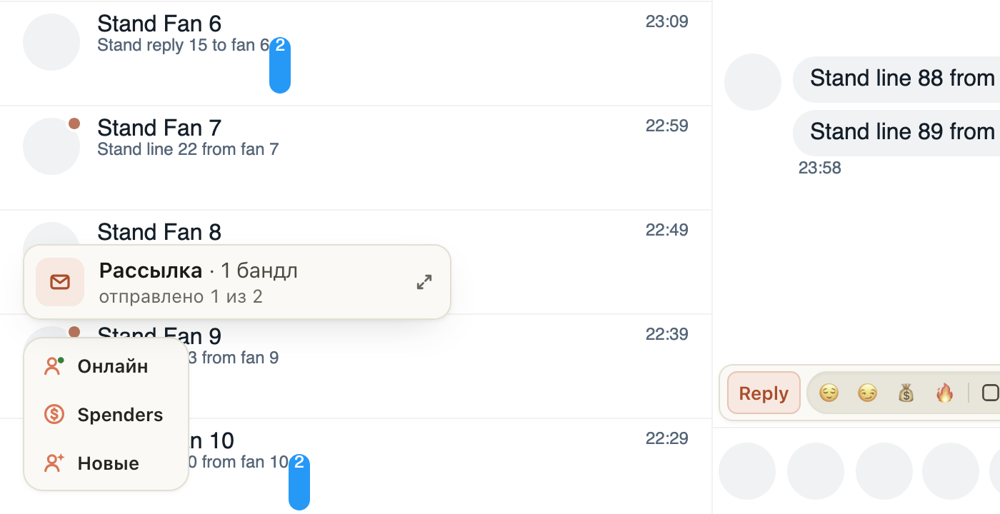

# «Рассылка» сохраняется, и к любой можно вернуться с того же места

Раньше рассылка жила, пока открыта вкладка. Перезагрузка страницы (на Fansly она бывает после «Открыть чат»),
перезапуск браузера или «Новая рассылка» стирали версии и отметки, кому уже ушло.

Теперь каждая рассылка страницы хранится на этом компьютере: текст, «Кому», версия для каждого фана, ваши правки,
кому ушло и кто ответил. После перезагрузки плашка «Рассылка» снова стоит в углу, нажмите её и продолжайте с того же
фана. В шапке окна есть «Рассылки»: там все рассылки страницы за 30 дней и «Новая рассылка». Нажмите любую, и окно
откроет её как было. То, что ушло или могло уйти, повторно не отправится.

## Как это устроено

Рассылки лежат в хранилище расширения в браузере (до 20 на страницу, 30 дней, не больше 2 МБ), отдельно для каждого
пользователя и страницы. При выходе из аккаунта они стираются. Вкладки одной страницы видят одни и те же рассылки:
перед отправкой окно проверяет, не ушла ли эта версия из другой вкладки. Отправка, которая была в пути, когда
вкладка закрылась, после возврата считается «неизвестно, ушло ли» и сама не повторяется.

На Fansly после перезагрузки возвращается всё, включая готовые версии. В ChatSpace версия живёт в карточке фана,
поэтому неотправленные версии после перезагрузки пишутся заново одной кнопкой «Дописать N». Отметки отправленных и
ответы остаются.
