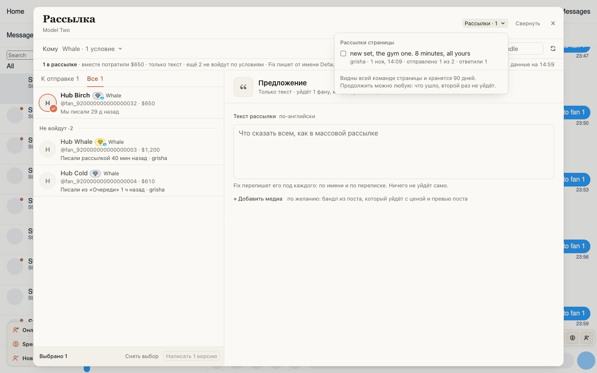
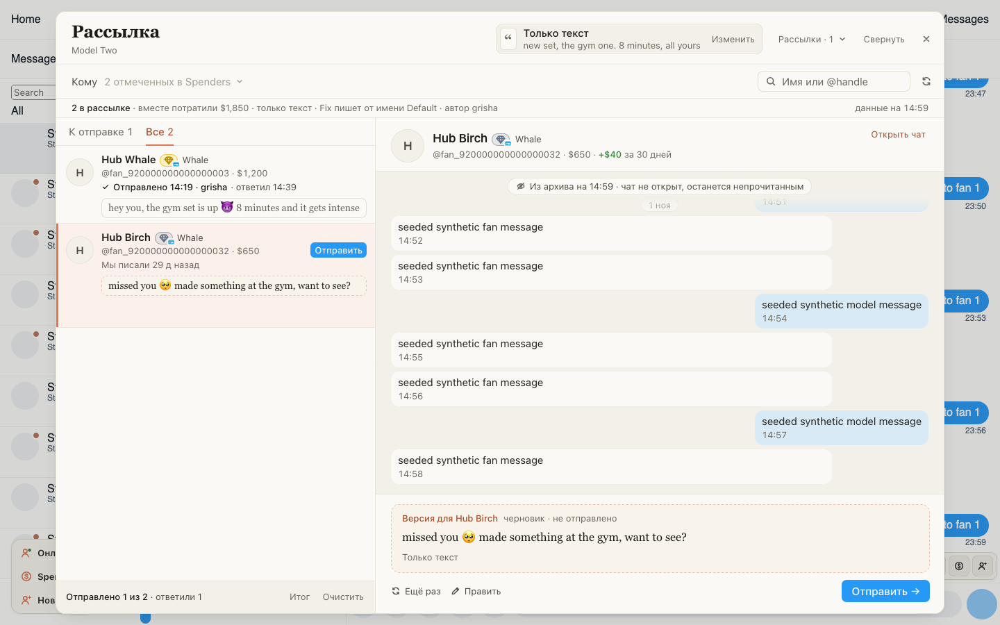
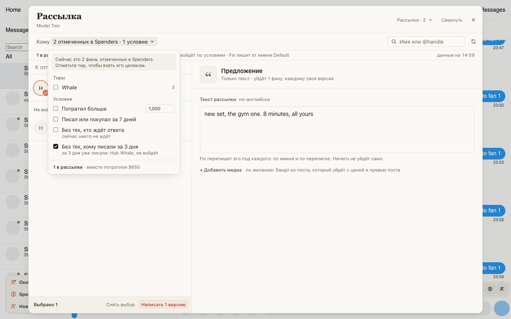

# «Рассылки» видит вся команда страницы, продолжить можно любую

Раньше рассылка жила на одном компьютере: коллега её не видел, а с другого браузера к ней было не вернуться.
Теперь в «Рассылках» в шапке окна все рассылки страницы, у чужих стоит имя автора. Нажмите любую, и она откроется
с того же места: у отправленных стоит «Отправлено · имя», остальные версии ждут вашей кнопки.

- Одному фану версия рассылки уходит один раз, кто бы ни нажал и с какого компьютера.
- Фан, которому за 3 дня уже писали рассылкой, «Очередью» или из «Онлайн», в новую рассылку по умолчанию не
  входит. Условие «Без тех, кому писали за 3 дня» можно снять.
- Если связи нет, окно скажет «Хаб не отвечает», и отправить можно всё равно.

## Как это устроено

Рассылки хранятся на хабе 90 дней: текст, «Кому», версия для каждого фана, правки и отправки. Видят их все, кому
выдана страница. Перед каждой отправкой окно бронирует фана на хабе: если коллега уже отправил ему эту рассылку
или отправляет прямо сейчас, кнопка не сработает и покажет, кто. Отправку с неизвестным итогом («Могло уйти»)
никто не повторяет; когда сообщение появится в переписке, хаб сам поставит «Отправлено».

Открытое окно перечитывает рассылку раз в 15 секунд: отправки и правки коллеги появляются сами. Без связи
рассылка хранится на этом компьютере и уходит на хаб, когда он ответит. Рассылки, сохранённые на компьютере в
3.15.0, переедут на хаб сами. В ChatSpace готовые версии возвращаются в карточки фанов, писать их заново не нужно.
Отправка рассылки считается касанием и для «Очередей» с «Онлайн»: фан, который не ответил, пропадает оттуда на 21 день.
