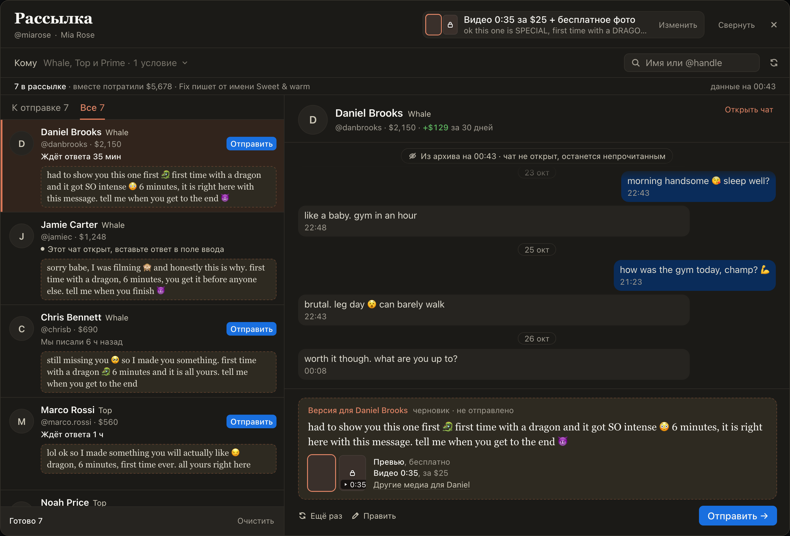
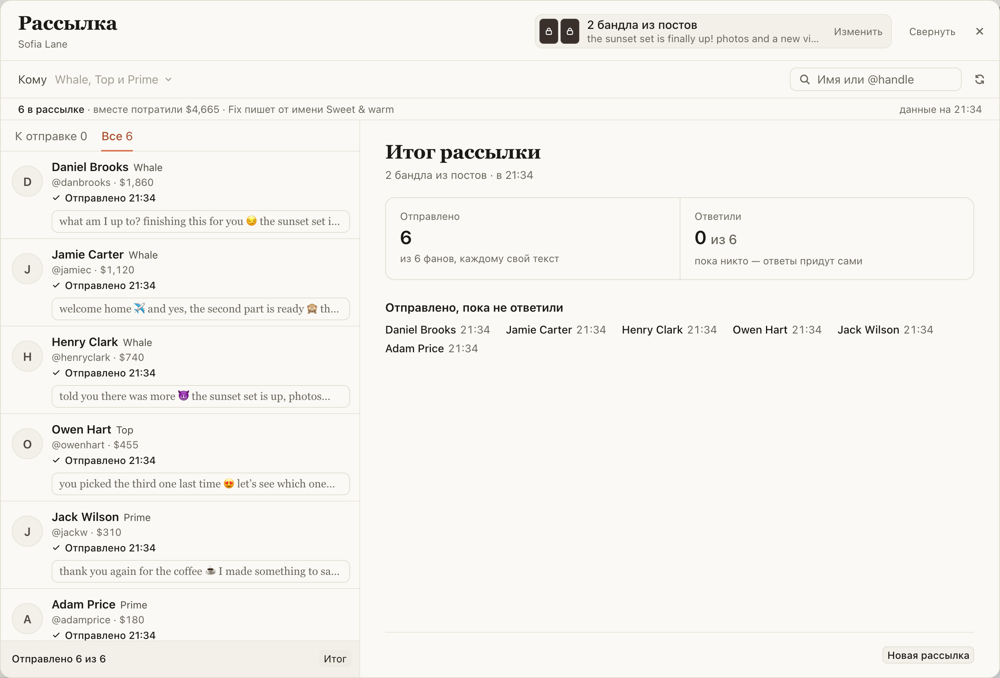

# Рассылка в своём окне: кому писать, версия каждому фану и итог рассылки

Для чаттеров, которые предлагают новое видео крупным фанам лично. Раньше рассылка была полосой в Spenders,
теперь у неё своё окно, как у «Новых».

- В Spenders нажмите «Рассылка». В «Кому» тиры (сразу Whale, Top и Prime) и условия: «Потратил больше»,
  «Писал или покупал за 7 дней», «Не купил это видео», «Без тех, кто ждёт ответа». Кого условие не берёт,
  видно внизу списка с причиной.
- Справа напишите текст и добавьте медиа: на OnlyFans — видео из волта с ценой и бесплатное превью, на Fansly —
  бандлы, скопированные в посте.
- «Написать N версий»: Fix напишет каждому свою. Справа карточка фана с перепиской и версией, «Отправить →»
  отправляет и открывает следующего.
- «Свернуть» прячет окно в плашку, пока вы отвечаете в чатах.
- «Итог рассылки»: сколько ушло, кто купил или ответил, что не ушло и почему.

## Как это устроено

Список берётся из Spenders: тиры и суммы за всё время, кто писал последним. Версию пишет Fix по тексту рассылки
с заданием рассылки из хаба, по две версии одновременно. После «Написать N версий» состав рассылки не меняется.
Если поменять текст, неотправленные версии переписывает одна кнопка «Переписать N», ушедшие остаются как были.

На OnlyFans версия уходит как «Отправить» в превью: через очередь ChatSpace, с медиа рассылки или со своими
медиа фана («Другие медиа для …» в карточке). Чат, открытый у вас в ChatSpace, отсюда не отправить: в карточке
будет «Открыть и вставить». «Не купил это видео» спрашивает у волта, кто уже купил платное видео. На Fansly
версия уходит сообщением с бандлами из «Copied», цена и превью заданы в посте.

Одно «Отправить» — одно сообщение и одна попытка, между отправками полсекунды, всем сразу отправить нельзя.
«Неизвестно, ушло ли» не отправляется повторно: проверьте в чате. «Очистить» убирает только неотправленные
версии. Ответы фанов и покупки итог читает из архива несколько раз, всё реже; чаты при этом не открываются.
