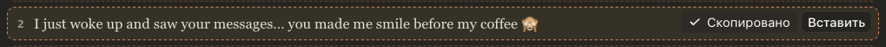

# «Копировать» у варианта ответа срабатывает и при неточном клике

Клик по строке варианта вставляет его в поле, а значок копирования маленький: если чуть промахнуться мимо
него, текст вставлялся вместо копирования. Теперь клик рядом со значком (в нескольких пикселях от него)
копирует, как сам значок. Клик по тексту варианта вставляет, как раньше.

## Как это устроено

Строка варианта по-прежнему целиком кнопка «Вставить», кроме своих кнопок. Если клик пришёлся не на кнопку,
но не дальше 8 px от значка копирования, строка копирует этот вариант. Так работает везде, где показаны
варианты: в панели, в превью Spenders и «Новых», на OnlyFans, Fansly и в Telegram. Если копирование закрыто
(черновик Coach на кириллице), строка, как и значок, говорит почему.
