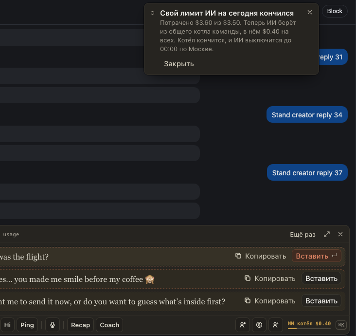
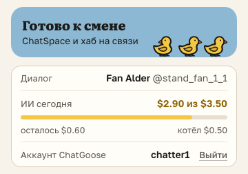

# Общий котёл ИИ, и «ИИ сегодня» в окне расширения видно сразу

Всё, что команда недотратила вчера из своих лимитов ИИ, складывается в общий котёл на сегодня. Когда ваш лимит кончился, ИИ не выключается, а берёт из котла, пока там есть деньги: на полосе ChatGoose жёлтое «ИИ котёл $0.40», всплывает предупреждение с остатком котла. Когда пусты и лимит, и котёл, ИИ не работает до 00:00 по Москве.

В окне расширения строка «ИИ сегодня» теперь появляется сразу, как оно открылось: сколько потрачено из лимита («$2.90 из $3.50»), полоска, сколько осталось своего лимита и сколько в котле. У кого личного лимита нет, видно, сколько ИИ стоил сегодня, с пометкой «без лимита».

## Как это устроено

Котёл на день по Москве: сумма того, что каждый с лимитом не потратил из своего лимита вчера. Дальше одного дня он не копится и общий на всех. Хаб пускает генерацию, пока у человека есть остаток своего лимита или в котле есть деньги, и отказывает (CG-AI-LIMIT с отсчётом до 00:00 МСК), только когда пусто и там, и там. Расширение держит последний ответ хаба о лимите и спрашивает его первым, когда окно открывается. Цифра обновляется при запуске, раз в 5 минут и через 3 секунды после каждой генерации, так что остаток котла может отставать на несколько минут от трат других. Предупреждения по одному разу за день: на 80 % своего лимита, когда начался котёл и когда кончилось всё. Строка «Квота AI» теперь называется «Квота ИИ».
