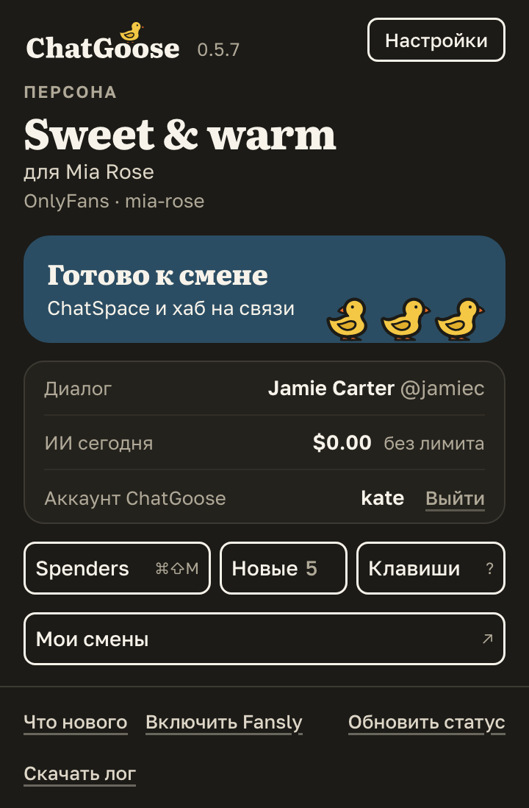

# «Мои смены» в окне расширения открывают Workboard без пароля

Ваши смены и продажи по данным хаба лежат в Workboard, но туда приходилось входить отдельно, со своим логином
и паролем. Теперь в окне расширения (значок ChatGoose на панели браузера) есть кнопка «Мои смены»: она открывает
«Мои смены» в Workboard в новой вкладке, и вход уже выполнен под тем же аккаунтом, что и в расширении.

Кнопка видна всегда, когда вы вошли в расширение, даже без открытой вкладки ChatSpace или Fansly.

## Как это устроено

По нажатию расширение просит у хаба одноразовую ссылку для этого устройства и сразу открывает её. Ссылка
работает один раз и одну минуту. Вход по ней открывает только ваш раздел Workboard (смены, отчёты, статистику)
и не открывает экраны владельца; он заканчивается, когда вы выходите из расширения или вход устройства
отзывают в хабе.

Если хаб не дал ссылку (старая версия хаба, нет связи, ответа нет 10 секунд), открывается обычный адрес
Workboard, и там нужно войти как раньше. Новых разрешений расширение не просит.
