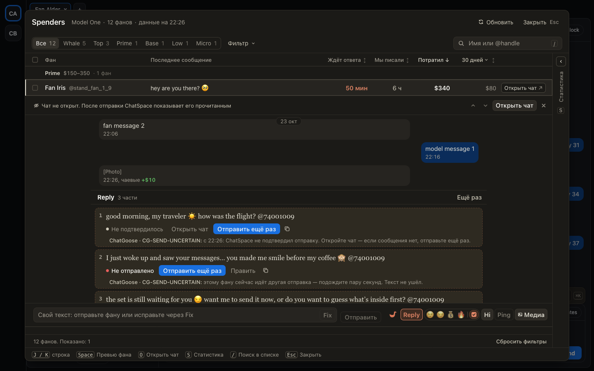
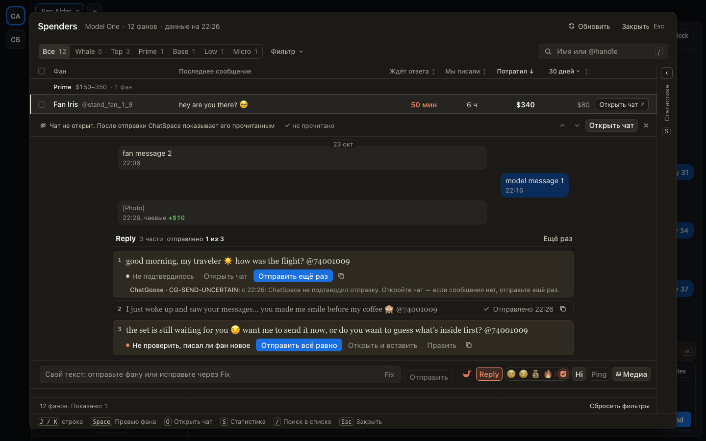

# «Отправить» в превью не застревает после сбоя, а ваш текст не пропадает при отказе

В превью Spenders и «Новых» было три неприятности с «Отправить»:

- отправка части не подтвердилась, вы сразу нажали «Отправить ещё раз» или «Отправить» у следующей
  части — и кнопка переставала отправлять примерно на полчаса;
- «Отправить всё равно» после «Фан написал новое» иногда ничего не делала;
- свой текст из поля под перепиской пропадал, если ChatSpace отказывал (чат ведёт Mimic, включён
  автоперевод, после загрузки страницы ещё не открывали ни одного чата): после перезагрузки его было не вернуть.

Теперь в первые секунды после сбоя под частью написано «этому фану сейчас идёт другая отправка —
подождите пару секунд», рядом «Отправить ещё раз»: через несколько секунд она отправляет как обычно.
«Отправить всё равно» отправляет. Если отправка точно не ушла, ваш текст возвращается в поле — когда вы
ничего туда не написали за это время.

## Как это устроено

Каждое нажатие «Отправить» — один запрос к хабу на разрешение. Пока у предыдущей отправки этому фану
не истекли её 10 секунд, хаб отказывает. Раньше расширение считало такой отказ «другой отправкой с
неизвестным исходом» и не пускало новые нажатия этой части, пока запись не устаревала (30 минут). Теперь
отказ ничего не держит: следующее нажатие снова спрашивает хаб, и после этих 10 секунд хаб отправку
пропускает. Первая отправка остаётся «Не подтвердилось»; сама по себе ничего не повторяется — только по
вашему нажатию.

Остановку «Фан написал новое» снимает только «Отправить всё равно»: обычное «Отправить» по-прежнему
останавливается на ней.

Текст из поля переходит в карточку в момент нажатия. Если отправка точно не дошла до фана (остановлена
до очереди ChatSpace, очередь её не взяла, сервер ChatSpace отказал), текст возвращается в пустое поле и
сохраняется вместе с черновиками. Если исход неизвестен или сообщение ушло, текст в поле не
возвращается, чтобы его не отправили второй раз. Если ChatSpace ещё не готов отправлять из превью,
всплывающее сообщение говорит почему.
