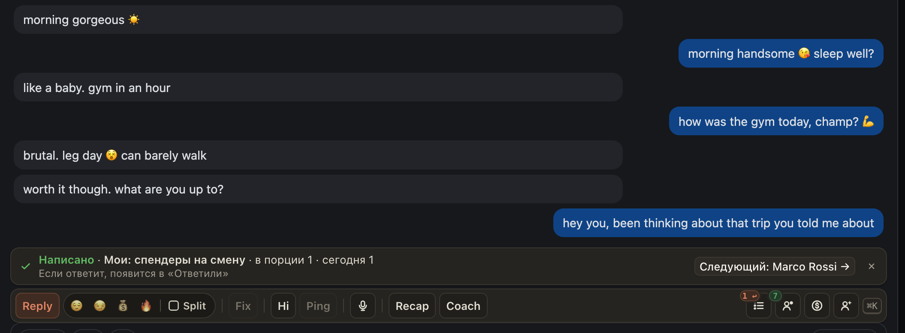

# Очередь теперь идёт с вами по чатам

Раньше «Открыть чат» закрывало окно очереди, а сообщение, написанное в чате, в очереди не считалось: приходилось возвращаться в окно, и там открывался тот же фан.

Теперь над панелью стоит полоска: кто этот фан в очереди и зачем ему писать. Пишите как обычно, через Ping, Fix, Coach или руками. Отправили: полоска говорит «Написано», сообщение засчитано само, а кнопка открывает следующего фана. Сам чат никогда не переключается, только по вашему клику. Вернулись из другого чата: полоска там же, одной строкой. После перезагрузки страницы очередь на месте.

В начале дня полоска напомнит, что вас ждут фаны из очереди: «Начать» или «Не сегодня». В окне «Начать в чате» запускает то же самое, а внизу видно, сколько всего вы написали, сколько ответили и сколько они потратили. Кто ушёл из порции (написал сам, ему уже написали), видно там же, с причиной. На Fansly «Очереди» появились и в угловом меню.

## Как это устроено

Хаб считает сообщение в очередь по отчёту об отправке: если вы написали фану из своей порции или из своей очереди, он отмечен как написанный, с тем, чем написано (Ping, Reply, Hi или свой текст). Сообщение другого чаттера вам не засчитывается, фан просто уходит из порции. Если фан сам написал или купил раньше вашего сообщения, это ответ ему, а не работа очереди. Порцию хаб теперь перепроверяет каждую минуту, пока вы её держите, а не только при выдаче: холодный шаблон не уйдёт тому, кто только что написал сам. Кампания, в которой никого не осталось, закрывается сама. «Ещё 10» в очередях, которые пишут по одному, больше не упирается в лимит страницы: он только для рассылок пачкой. В очереди со своим текстом нет лишних кнопок Hi и «Шаблон», а сообщение очереди называется своим именем.
