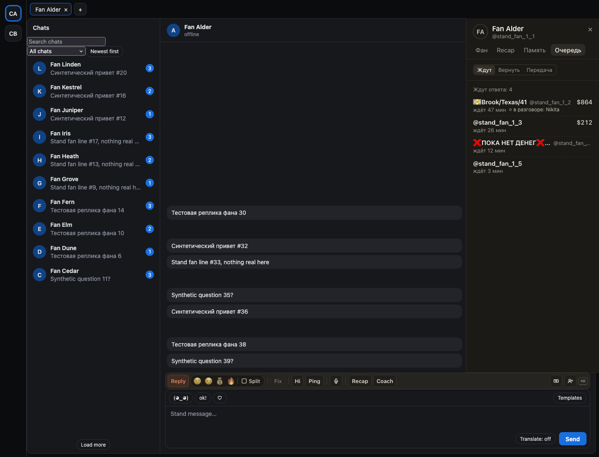
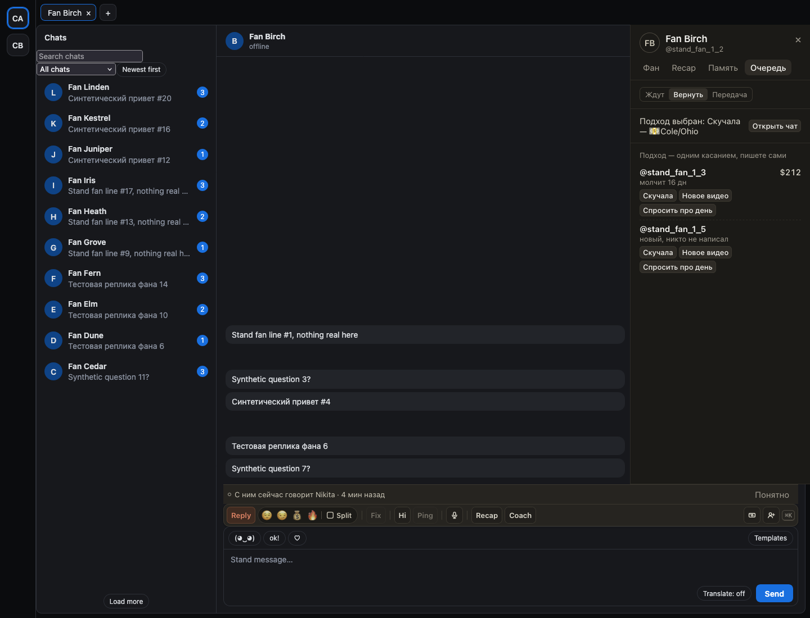
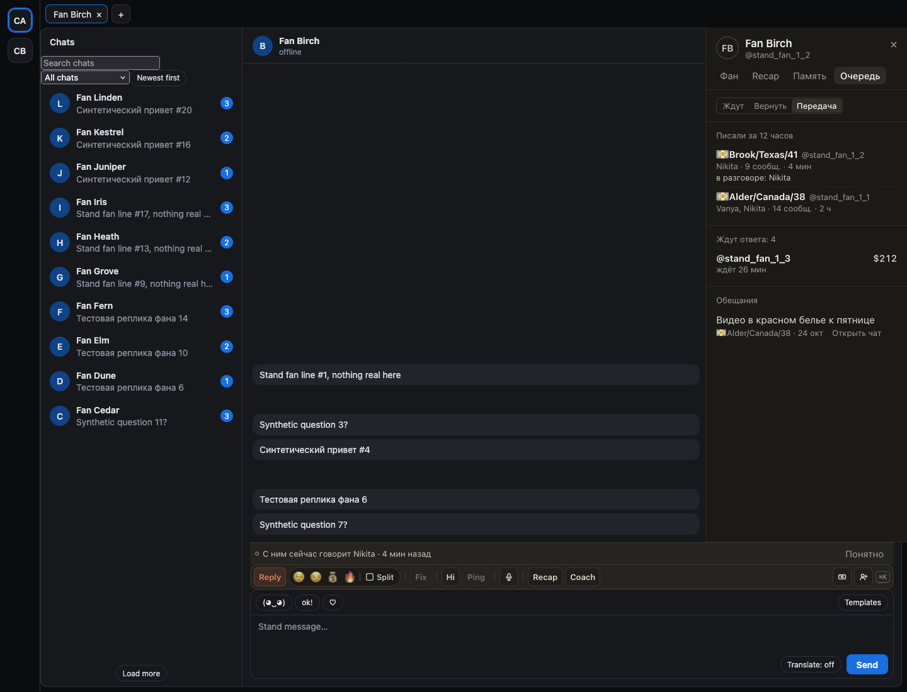

# «Очередь» в панели фана: кто ждёт ответа, кого вернуть и что передать следующей смене

В панели фана (`]`) появилась вкладка «Очередь». Она про страницу, а не про чат: остаётся на месте, когда вы
открываете чат из её строки.

«Ждут» показывает всех, кто написал за 30 дней и кому не ответили, не только плативших: псевдоним с 💵 и ❌, сколько ждёт,
сколько потратил, «в разговоре: Никита». Рассылка больше не считается ответом.

«Вернуть» подсказывает, кого стоит вернуть сейчас и почему: «подписка кончается через 2 дн», «новый, никто не написал»,
«молчит 16 дн». Нажмите подход владельца: фан уйдёт из списка, сверху появится «Подход выбран» и «Открыть чат».
Пишете вы сами.

«Передача» пригодится в начале смены: кому писали за 12 часов и кто, кто ждёт ответа, обещания из переписки (если
их нет, «не знаю»).

## Как это устроено

Вкладка обновляется сама раз в полминуты и читает хаб, только пока открыта, и только свой раздел. Выбор подхода
отправляет один запрос к хабу, он не повторяется сам; хаб запоминает выбор и потом считает, ответил ли фан и купил ли он
что-то. Сам фан ничего не получает: расширение ничего не отправляет. «Вернуть» и «Передача» появляются, когда их
отдаёт хаб; «Ждут» есть всегда.
